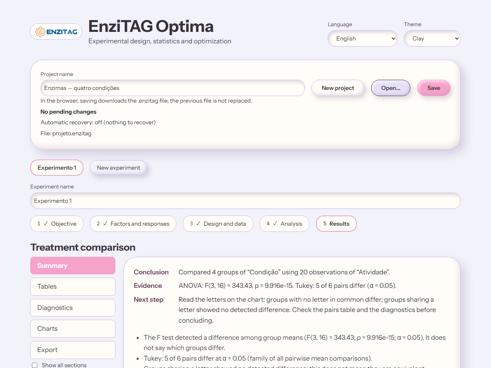

# Guia dos resultados

**Estado:** vigente · **Atualizado em:** 2026-11-02

A página de resultados organiza cada análise em **seções**, escolhidas na barra lateral (ou nos botões acima do conteúdo em telas estreitas). A seção ativa é lembrada nesta sessão para o mesmo resultado. Um novo cálculo começa pelo Resumo. No computador, as seções ficam acima do conteúdo quando a lista de etapas está expandida. «Mostrar todas as seções» reúne tudo numa página longa, como na v0.1. Capturas (seis temas, PT e EN) em [`docs/imagens/capturas/`](../imagens/capturas/).

## Seções por tipo de análise

| Análise | Seções |
|---|---|
| Comparação de tratamentos | Resumo · Tabelas (ANOVA, grupos, pares) · Diagnóstico · Gráficos · Exportar |
| Planejamento de dois níveis | Resumo · Efeitos · Diagnóstico · Gráficos · Exportar |
| Superfície de resposta | Resumo · Modelo (termos, equação, comparação de modelos) · Diagnóstico · Gráficos (contorno e 3D) · Otimização · Confirmação · Exportar |

**Exportar é sempre a última seção.** Os botões de CSV, XLSX, SVG, PNG e PDF de cada tabela e figura também ficam junto dela.

## Resumo

Conclusão, evidência e próximo passo em frases curtas, com os números principais (F, valor-p, número de pares que diferem). O texto diz o que o resultado **não** significa (por exemplo, que o teste F não indica quais grupos diferem).

## Modelo (superfícies)

- Cada termo do modelo pode ser ligado ou desligado; o aplicativo recalcula na hora. Remover um termo que quebra a hierarquia exige confirmação.
- Há **um modelo por resposta**; o seletor de resposta mostra qual já tem modelo. A otimização usa o modelo de cada resposta e marca o resultado como desatualizado se o modelo mudar.
- **Sugerir remoções:** eliminação regressiva (remove o termo de maior valor-p acima de α que respeite a hierarquia, recalcula e repete). A sequência mostra o efeito de cada passo; a decisão final é sua.
- **Comparação:** modelo completo, atual e recomendado, com R², R² ajustado, R² predito (PRESS), AICc, BIC e valores-p do modelo e da falta de ajuste. O aplicativo não declara um vencedor único: veja [seleção de modelos](../metodos/selecao-de-modelos.md).

## Diagnóstico

Resíduos × ajustados, gráfico normal dos resíduos, razão de desvios e teste de homogeneidade. Os avisos aparecem em todas as seções quando os dados mudaram depois do cálculo («resultado desatualizado»).

## Gráficos

Médias com a incerteza nomeada e letras de comparação, boxplot, Pareto, efeitos, observado × predito, contorno e superfície 3D. Cada figura tem personalização própria (título, eixos, cores, letras manuais, anotações) salva no projeto.

## Otimização e confirmação

Objetivos (maximizar, minimizar, alvo, faixa), restrições, candidatos com previsão e incerteza, desejabilidade global e compromissos entre respostas; depois, a proposta de ensaios de confirmação e a comparação com o observado. A busca é local com vários inícios: **não há afirmação de ótimo global**.

## Exportar

Relatório HTML, PDF e Word (completos, em sequência), tabelas em CSV e XLSX, figuras em SVG, PNG e PDF e as preferências de exportação (decimais, paleta, idioma do relatório, logotipo do grupo). Ver o [guia de exportação](exportacao.md).

## Resultados que não ficam guardados no projeto (v0.3)

Misturas (Scheffé), modelo misto e comparação pareada, curva de saturação e calculadora de potência são **calculados ao pedir**. O projeto guarda os dados e as opções, mas **não** o resultado destas análises, e elas **não** entram nos relatórios: ao reabrir um projeto, peça a análise de novo. As análises anteriores (comparações, procedimentos, ANOVA multifatorial, planejamentos de dois níveis, superfícies e otimização) continuam guardadas e **não são recalculadas** ao reabrir. Guardar os resultados novos está previsto para a v0.4 ([plano](../planos-execucao/plano-v0.4.md#et22--resultados-das-famílias-novas-guardados-no-projeto)).

## Teclado e acessibilidade

Setas, Tab e Enter percorrem a barra de seções; o item ativo é indicado por texto e por `aria-current`, não só por cor. Todos os temas passam na verificação de contraste e do axe, e há tratamento para alto contraste do Windows e movimento reduzido.

## Percurso da v0.4 (ET29)

Cada cartão inicial tem seu próprio «Começar». Dentro da etapa, um só par Anterior/Seguir conduz pelos blocos; o último avanço leva à próxima etapa. «Mostrar todos os blocos» vale no dispositivo para todas as etapas. Ao voltar, o bloco é lembrado; um planejamento já gerado abre na grade para preencher as respostas.

A análise oferece estrutura independente ou medidas repetidas, resposta, método, modelo/blocos, contrastes e revisão antes do cálculo. Os pesos de um contraste são digitados ao lado de cada nível e precisam somar zero, com pelo menos um peso não nulo. O resumo identifica resposta, procedimento, fatores/termos, bloco e α. Para medidas repetidas, escolha a coluna de unidade ou um fator identificador; confira os pares disponíveis antes de executar.

A ET22 guarda mistura, pareado/modelo misto, saturação e potência na etapa Resultados. Reabrir mostra o registro sem calcular novamente; editar dados ou opções marca o resultado antigo. Em potência, editar a tabela não altera as hipóteses prospectivas.

Figuras recortam as marcas na área dos eixos; notas e títulos longos ganham linhas e altura. Pareto usa uma linha crítica identificada; interações têm amostras de linha e níveis reais. A revisão estética por família foi conferida na ET27.

## Aparência e leitura na v0.4

Os seis temas compartilham papéis de títulos, rótulos, ajuda e números. Valores arredondados na tela oferecem o valor completo ao foco ou ponteiro; os arquivos de tabela mantêm a precisão do motor. O menu **Figura** reúne personalização, comentários, exportação e prévia neutra. Tabelas e figuras extensas rolam no próprio contêiner; o texto continua disponível com ampliação de 200%. A [avaliação da ET27](../../validation/reports/et27/README.md) registra cobertura e limites.

## Famílias e cálculos guardados (ET22)

Quando há mais de uma família calculada, escolha **Família de resultados**. Dentro dela, **Cálculo guardado** permite consultar registros anteriores; essa consulta não muda a configuração em edição. Ao abrir um arquivo, o mais recente é selecionado. Um novo cálculo abre o Resumo. As entradas usadas, revisão e instante identificam o registro; rótulos, unidades e pontos da figura vêm da revisão original.

Tabelas, figuras, comentários e relatórios correspondem ao cálculo consultado. A exportação inclui todas as seções mesmo com somente uma visível. Os exemplos 07, 08, 11 e 12 já trazem resultados. Um erro de cálculo não remove o último resultado válido.
