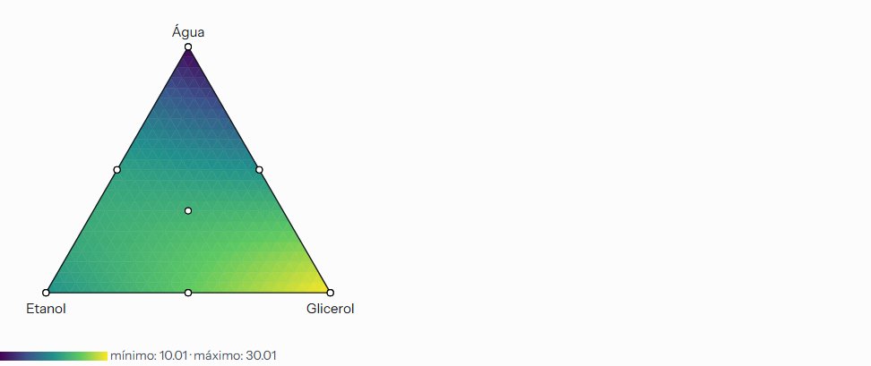

# Planejamentos de misturas e modelos de Scheffé

**Estado:** implementado; geração e modelos validados contra referências independentes · **Atualizado em:** 2026-11-04

| Campo | Valor |
|---|---|
| IDs no registro do motor | `mixture_design` (geração) e `mixture_model` (modelos de Scheffé) |
| Módulos | C13 `designs/mixture`, C06 `models/mixture` |
| Etapas | [ET15](../planos-execucao/concluidos/et15-niveis-mistos-e-misturas.md) e [ET25 ativa](../planos-execucao/concluidos/et25-misturas-e-planejamentos-otimos-avancados.md) |
| Casos de validação | [`validation/cases/mixture_design`](../../validation/cases/mixture_design/mixture.json) (6 casos legados e 7 regiões limitadas) e [`validation/cases/mixture_model`](../../validation/cases/mixture_model/scheffe.json) (5 casos); gerador [`make_mixture_cases.py`](../../validation/tools/make_mixture_cases.py) |

## 1. Pergunta

Em que proporções misturar `q` componentes (que somam 1) para estimar como a resposta depende da composição, e qual modelo descreve essa dependência?

## 2. Pressupostos

As proporções somam 1 em todos os ensaios; cada ensaio é uma unidade experimental independente; o erro é aditivo, independente e de variância constante. Limites inferiores `Lᵢ` com `ΣLᵢ < 1`. Limites superiores opcionais `Uᵢ` restringem a região a `Lᵢ ≤ xᵢ ≤ Uᵢ`, com soma dos superiores ≥ 1. Restrições lineares gerais não são tratadas.

## 3. Entradas e opções

**Geração:** 2 a 8 componentes com nome e limite inferior; limites superiores opcionais; tipo (simplex-lattice de grau 1 a 6, simplex-centroide ou vértices/arestas da região com 1 a 6 partes por aresta); repetições (≥ 1); pontos centrais extras (0 a 100); aleatorização e semente (0 a 2⁵³ − 1 na interface). **Análise:** modelo (linear, quadrático, cúbico especial — este com 3 ou mais componentes), α dos intervalos.

## 4. Fórmulas

Pseudocomponentes `x′ᵢ = (xᵢ − Lᵢ)/(1 − ΣL)`; proporções reais `xᵢ = Lᵢ + (1 − ΣL)·x′ᵢ`.
Scheffé: `E(y) = Σ βᵢx′ᵢ [+ Σ βᵢⱼx′ᵢx′ⱼ [+ Σ βᵢⱼₖx′ᵢx′ⱼx′ₖ]]`, **sem intercepto**.
ANOVA com soma total **centrada**: `SQT = Σ(y − ȳ)²` (n − 1 gl), `SQR = SQT − SQE` (posto − 1 gl), `F = (SQR/gl)/(SQE/gl)`, `R² = 1 − SQE/SQT`, `R²aj = 1 − (1 − R²)(n − 1)/(n − posto)`.

## 5. Algoritmo numérico

**Lattice `{q, m}`:** vetores inteiros de soma `m` em ordem lexicográfica crescente (o primeiro componente varia mais devagar), pseudocomponentes `a/m`; número de pontos `C(m + q − 1, q − 1)`. **Centroide:** subconjuntos não vazios por tamanho e ordem lexicográfica, partes iguais `1/k`; `2^q − 1` pontos. Repetições repetem todos os pontos; os centrais extras vêm por último; a execução é uma permutação da ordem padrão (PCG32 e Fisher–Yates, [aleatorização](aleatorizacao.md)). **Ajuste:** mínimos quadrados por QR com pivoteamento (o mesmo do [modelo linear](regressao-linear.md)) sobre as colunas do modelo; com três componentes, previsões em uma malha triangular de 24 subdivisões (até 325 pontos). Só são guardados pontos dentro dos limites e estimáveis pelo ajuste. Uma célula da figura só recebe cor quando seus três vértices têm previsão válida. A transformação em pseudocomponentes continua definida pelos limites inferiores, inclusive na região limitada.

## 6. Saídas

Planejamento: pontos distintos, total, ensaios (execução, ordem padrão, suporte, pseudocomponentes, proporções, repetição). Análise: coeficientes com erro-padrão, t, valor-p e intervalo; ANOVA centrada; `R²` e `R²` ajustado; resíduos e diagnósticos por observação; malha ternária.

## 7. Casos sem resultado válido

`design.mixture_*` (componentes, nomes, limites, grau, centrais) e `design.too_many_runs`; `mixture.invalid_*` (dimensões, limites, proporções que não somam 1 ou abaixo do limite) e `mixture.special_cubic_needs_three`. Aviso `design.mixture_no_pure_error` sem repetições nem centrais. Modelo com mais parâmetros que ensaios: coeficientes não estimáveis são listados como aliasados, sem inventar valores. A estimabilidade é conferida também para cada previsão. Faixas superiores inviáveis, tipo de geração incompatível e região não resolvida produzem erro explícito. Região com dimensão reduzida e previsões omitidas recebem aviso.

## 8. Exemplo

Lattice `{3, 2}` com um central extra e duas repetições: 6 pontos × 2 + 1 = 13 ensaios; o modelo quadrático tem 6 coeficientes e 7 graus de liberdade residuais.

## 9. Interpretação apresentada ao usuário

O aplicativo explica que **não há intercepto** (os termos lineares já contêm o nível médio), que os coeficientes estão em pseudocomponentes e que a previsão só vale dentro da região do planejamento. O gráfico ternário usa escala viridis (acessível a daltonismo) com a tabela de coeficientes como equivalente em texto.

## 10. Validação

`mixture_validation.rs`: a geração coincide com `itertools` e PCG32 em Python (ordem padrão, suporte, pseudocomponentes e proporções a 1e-14); os modelos (linear, quadrático e cúbico especial; 2, 3 e 4 componentes; com limites inferiores) coincidem com o `statsmodels.OLS` sem intercepto em coeficientes, erros-padrão, t, valores-p e intervalos (tolerância relativa ≤ 1e-7) e com a ANOVA centrada calculada em Python (`F`, valor-p, `R²`, `R²` ajustado). E2E com o motor real: gerar, preencher, ajustar e ver o gráfico ternário.

## 11. Referências

Cornell, J. A. *Experiments with Mixtures*, 3.ª ed.; Scheffé, H. (1958) «Experiments with mixtures», *JRSS B* 20; Montgomery, D. C. *Design and Analysis of Experiments*, cap. 11.

## Limitações desta versão

- Sem restrições lineares gerais, modelos cúbicos completos, transformação de razões e **otimização por desejabilidade no simplex**. A otimização segue em T05 da ET25.
- A partir da ET22, a análise é guardada com suas entradas e revisão, sem recálculo ao abrir; integra HTML/PDF/Word e tabelas CSV/XLSX. As limitações metodológicas acima conservam seus destinos na ET25.
- Sem teste de falta de ajuste nem PRESS nos modelos de misturas.

## 12. Extensão ET25 — região limitada (aceite incremental local)

### Região e compatibilidade

A região passa a ser definida por `Σxᵢ = 1` e `Lᵢ ≤ xᵢ ≤ Uᵢ`. Os limites superiores são opcionais, com valor efetivo 1 quando ausentes. As entradas anteriores continuam com a geração lattice/centroide e a mesma transformação de pseudocomponentes. Limites superiores podem produzir uma região poliédrica, exigindo construção própria do planejamento. [NIST, misturas restritas](https://www.itl.nist.gov/div898/handbook/pri/section5/pri554.htm).

O contrato de geração recebeu limites superiores opcionais e uma variante explícita para vértices da região e subdivisões das suas arestas. A variante tem grau de subdivisão de 1 a 6. O grau 1 inclui os vértices, o grau 2 acrescenta os pontos médios das arestas e graus maiores dividem as arestas em partes iguais. Centrais extras são repetições da média dos vértices, que pertence à região convexa. O tipo e os pontos gerados são identificados na interface e nos arquivos.

Vértices são obtidos no Rust fixando todos os componentes exceto um nos respectivos limites e resolvendo a soma para o componente restante. Remover duplicatas numericamente equivalentes, preservar os limites ativos e ordenar deterministicamente. Arestas devem pertencer à fronteira da região e ter uma dimensão livre. Combinações de vértices que atravessem uma face ou o interior exigem identificação distinta e ficam fora dessa subdivisão de arestas. A referência independente usa interseção de semiespaços e programação linear no SciPy. A contagem deve conferir o limite de ensaios antes de materializar repetições.

Faixas inválidas, somas de limites inviáveis e região numericamente não resolvida recebem diagnóstico explícito. Uma região reduzida a um ponto ou a dimensão menor deve ser identificada e não implica estimabilidade do modelo. Para a análise, preservar os pseudocomponentes definidos pelos limites inferiores, verificar os superiores e limitar as previsões ao domínio declarado. Os resultados históricos conservam sua região original.

### Evidências e limites do aceite

T03 teve conferência local no Rust e nos três navegadores. Os sete casos geométricos do SciPy, os seis casos legados e os cinco ajustes de Scheffé passaram. A região limitada tem persistência validada sem novo ajuste ao reabrir. O hexágono foi exercitado com seis temas, PT/EN, 375/1064 px e texto 100%/200%. Figuras e relatórios HTML/PDF/Word foram exportados. A matriz com posto deficiente não recebe cor no interior; arquivos v1 nessa condição apresentam aviso sem reescrever o resultado. A conferência Windows da extensão fica em T12 e não está concluída. Detalhes e evidências na [§9.13 da versão](../planos-execucao/plano-v0.4.md#913-início-do-bloco-08--extensões-da-et25-2026-11-04).

### Traços e otimização

O traço de Cox usa uma composição de referência explícita, conforme T04 e §13. Ao variar um componente, manter as razões entre os demais e restringir o caminho à região viável, preservando a soma igual a 1. A referência de composição e os intervalos percorridos deverão acompanhar a figura e os dados exportados. [Stat-Ease, direção de Cox](https://www2.statease.com/docs/latest/tutorials/mixture-designs/).

A otimização opcional reutiliza as regras de desejabilidade e os modelos de Scheffé do núcleo Rust, sujeita à soma e aos limites, conforme §14. T05 teve aceite incremental Rust/web, assim como o traço em T04; a qualificação Windows e o fechamento dos relatórios continuam em T11/T12 da ET25.

## 13. ET25 T04 — traço de Cox (aceite incremental local)

A requisição recebe uma composição real opcional `coxReference`. Ausente preserva os resultados/assinaturas anteriores, sem produzir traço. A seleção editável conserva os textos dos campos, inclusive entradas inválidas. A referência aceita precisa ter 2–8 frações finitas, respeitar os limites e somar 1 a 1e−9. Somente o pequeno erro de soma dentro dessa tolerância é normalizado, com a referência efetivamente usada guardada no resultado e mostrada ao usuário.

Na direção do componente i, `xᵢ = t` e `xⱼ = (1 − t) rⱼ / Σⱼ≠ᵢ rⱼ`. Intersectar cada faixa `Lⱼ ≤ xⱼ ≤ Uⱼ` para obter o intervalo viável de t. A soma dos demais componentes no denominador evita cancelamento perto de um vértice. Se todos os outros componentes da referência são zero, a direção daquele componente não está definida; guardar série sem intervalo/pontos e emitir aviso identificado. Uma faixa reduzida a um ponto é guardada como tal. Não inventar razões, composição balanceada ou caminho fora da região. Essa direção mantém as razões reais entre os demais componentes conforme o [manual Stat-Ease](https://www2.statease.com/docs/latest/tutorials/mixture-designs/#trace-plot).

O eixo horizontal comum é a alteração da fração real `Δxᵢ = xᵢ − rᵢ`, com zero na referência. Não é um coeficiente reparametrizado do modelo de Cox. Avaliar 51 posições igualmente espaçadas por intervalo e incluir a referência exatamente; guardar proporções reais, pseudocomponentes, Δxᵢ e previsão/estado indefinido para cada posição. A avaliação usa o mesmo modelo de Scheffé e a conferência de estimabilidade do ajuste, sem interpolar sobre previsões indisponíveis. Referência, intervalos, figura, dados fonte e exportações acompanham o registro imutável. Reabrir não ajusta nem reconstrói os dados científicos.

A referência independente usa programação linear SciPy para minimizar/maximizar cada componente sob as equações de razão e os limites, e álgebra NumPy para previsões e estimabilidade. Casos devem abranger 2–8 componentes, limites inferiores/superiores, componente fixo, referência em vértice e modelo com posto deficiente. O método passa à versão 3, com campos opcionais para leitura histórica. O aceite incremental T04 é Rust/web, com Windows integrado ainda pendente em T12.

A referência [cox.json](../../validation/cases/mixture_model/cox.json) tem oito casos, incluindo região reduzida a uma composição. Sete testes públicos de misturas passaram, abrangendo os casos novos e os anteriores. A integração revelou que resíduos de arredondamento de um componente fixo podiam criar uma coluna artificial ao normalizar o modelo. A transformação agora define exatamente zero para o pseudocomponente de um componente cujo limite inferior é igual ao superior (AU-B11). O ajuste, os caminhos e as previsões conferem contra a referência independente.

No app, T04 inclui a opção de traço com referência explícita, validação, marcação do resultado desatualizado, tabela da referência/domínio e dados fonte completos em CSV/XLSX. A figura diferencia componentes por padrões de linha, preserva pontos estimáveis isolados e nunca liga uma lacuna. O eixo usa o rótulo `Δx` para evitar o glifo subscrito ausente na fonte PDF. Os campos reutilizam o cartão e a grade de formulário comuns, com espaçamento e rótulos curtos. Três navegadores, seis temas/PT–EN e reflow foram conferidos. HTML/PDF/Word exportados, PDFs renderizados e XML Word inspecionado; não foi conferida a paginação nativa do Word. Os oito casos passaram no round trip Rust; o navegador reabriu o experimento criado do zero e quatro casos adversos sem ajuste. Detalhes do aceite e evidências permanecem na §9.13 da versão. A otimização no simplex não faz parte deste aceite.

## 14. ET25 T05 — otimização no simplex (aceite incremental local)

A otimização é uma extensão opcional da análise de mistura, com comando de interface explícito para ajustar e otimizar. O resultado e o pedido completo ficam no mesmo registro imutável da família, preservando a leitura dos arquivos sem essa extensão. A requisição recebe `optimization` com `setup` (objetivos, limites de resposta, busca e α) e `data` (identidade/nome, proporções e valores de cada resposta incluída). Cada resposta é ajustada separadamente pelo modelo de Scheffé escolhido. Objetivos, importância, desejabilidade individual/global e intervalos reutilizam as rotinas existentes. A interface informa o modelo comum às respostas e não substitui a comparação/revisão de modelos. Termos RSM não vazios e domínio estendido são recusados nessa extensão, em vez de interpretados silenciosamente.

O domínio da mistura é `Σxᵢ = 1`, com os limites inferiores/superiores declarados. Este domínio não aplica a definição de região/alavancagem do otimizador RSM. A busca não extrapola esses limites e a tela deve explicitar a diferença. Antes da busca, conferir a estimabilidade do modelo sobre o domínio admissível. Usar o espaço afim dos vértices para formar um simplex de dimensão plena relativa à região, com pontos obtidos por combinações convexas. As linhas do modelo em um lattice de grau igual ao grau do polinômio (1, 2 ou 3) formam uma verificação da restrição polinomial a esse espaço. Recusar o modelo se alguma dessas linhas não for estimável. Isso permite componentes fixos/região pontual e recusa um modelo quadrático identificado apenas nos vértices de uma região com interior. Posto numérico menor que a dimensão geométrica é diagnóstico explícito.

A busca local usa transferências entre pares de componentes, preservando a soma a cada proposta e respeitando as faixas. Executar inícios na média dos vértices, vértices e pontos viáveis produzidos por transferências aleatórias com PCG32/seed. Avaliar as transferências nos dois sentidos e reduzir o passo quando não houver melhora. Registrar tolerância de passo, tentativas efetivamente executadas, convergência, avaliações e limites atingidos. Pontos viáveis são comparados pela desejabilidade; limites obrigatórios mantêm prioridade sobre preferências. A função individual/global é a existente. O método é local com vários inícios e não prova ótimo global. Soluções próximas são agrupadas em distância de pseudocomponentes; platôs podem produzir vários candidatos equivalentes.

O orçamento inicial será explícito e sujeito à medição T10 antes do fechamento. Prever limites para respostas/observações, trabalho do ajuste e avaliações integradas, com recusa antecipada ou resultado parcial identificado. Um limite atingido nunca é descrito como convergência. A versão do método passa a 4 com a extensão, sem recalcular resultados antigos. Candidatos guardam proporções reais, pseudocomponentes, desejabilidade e previsões/intervalos por resposta. As opções/dados de todas as respostas entram na assinatura, incluindo valores ausentes ou inválidos que afetam a seleção.

A referência independente antecede a implementação. Usar mínimos quadrados NumPy e busca SciPy com igualdade de soma e bounds, com conferência adicional por malha para problemas pequenos ou programação linear nos casos lineares. Abranger máximo interior, fronteira, múltiplas respostas/pesos e limites obrigatórios, platô com mais de uma solução, componente fixo, região pontual e modelo não identificável. Os 16 casos de referência estão em [optimization.json](../../validation/cases/mixture_model/optimization.json), incluindo as quatro formas de objetivo, pesos, limites, platô e observações ausentes por resposta. A matriz pública de misturas passou em dez testes, com comparação de desejabilidade a 1e−6 e conferência de soma/faixas. O orçamento combinado real e a retenção de uma proposta melhor em rodada interrompida têm regressão explícita.

A revisão `pair-transfer-pattern/2` extrapola a direção combinada de transferências sucessivas, sempre limitada pelas faixas e contabilizada no orçamento. A reconstrução de uma coordenada livre preserva a soma; proposta numericamente não resolvida não é avaliada. O leitor aceita também a revisão 1, sem refazer a busca. No percurso real de duas respostas com uma observação ausente, a revisão 1 consumiu 80.000 avaliações e limitou os 40 inícios; a revisão 2 consumiu 20.626 e terminou os 40 pela tolerância. A desejabilidade permaneceu aproximadamente 0,500001. Isso mede avaliações desse caso, sem generalizar ganho de tempo/memória para todos os domínios. A medição T10 continua aberta.

Limites iniciais: oito respostas, 4.096 observações por resposta, trabalho de ajuste Σn·p² ≤ 10 milhões, 128 inícios, 2.000 avaliações por início e 100.000 combinadas. São limites conservadores a revisar na T10. Limite atingido gera aviso de resultado parcial, nunca convergência. Região pontual executa uma avaliação e não conta como término pela tolerância. Ausência de candidato e desejabilidade zero descrevem somente o que a busca encontrou (AU-B12).

O app conserva os campos editáveis como texto, valida antes de calcular, marca resultados desatualizados e oferece cancelamento. Objetivo de uma resposta removida fica visível e pode ser removido. A tela mostra trabalho realizado, objetivos/limites, candidatos e previsões com IC/IP; o melhor candidato aparece no ternário. CSV/XLSX preservam candidatos e metadados. O relatório inclui as previsões de todos os candidatos. Seis percursos passaram nos três motores, com axe de configuração/resultados, reflow e seis temas/PT–EN dos resultados; salvar/reabrir não ajusta modelos. Quatorze casos válidos e a revisão anterior passaram no round trip Rust; nove adulterações foram recusadas. Doze regressões T03/T04 e seis do RSM passaram. PDFs finais de quatro páginas foram renderizados e inspecionados, e Word foi conferido por XML. AU-U11 conserva a correção de paginação de múltiplos candidatos na T11; Windows integrado e fechamento cumulativo ficam em T12. Evidências e limites completos na §9.13 da versão.
