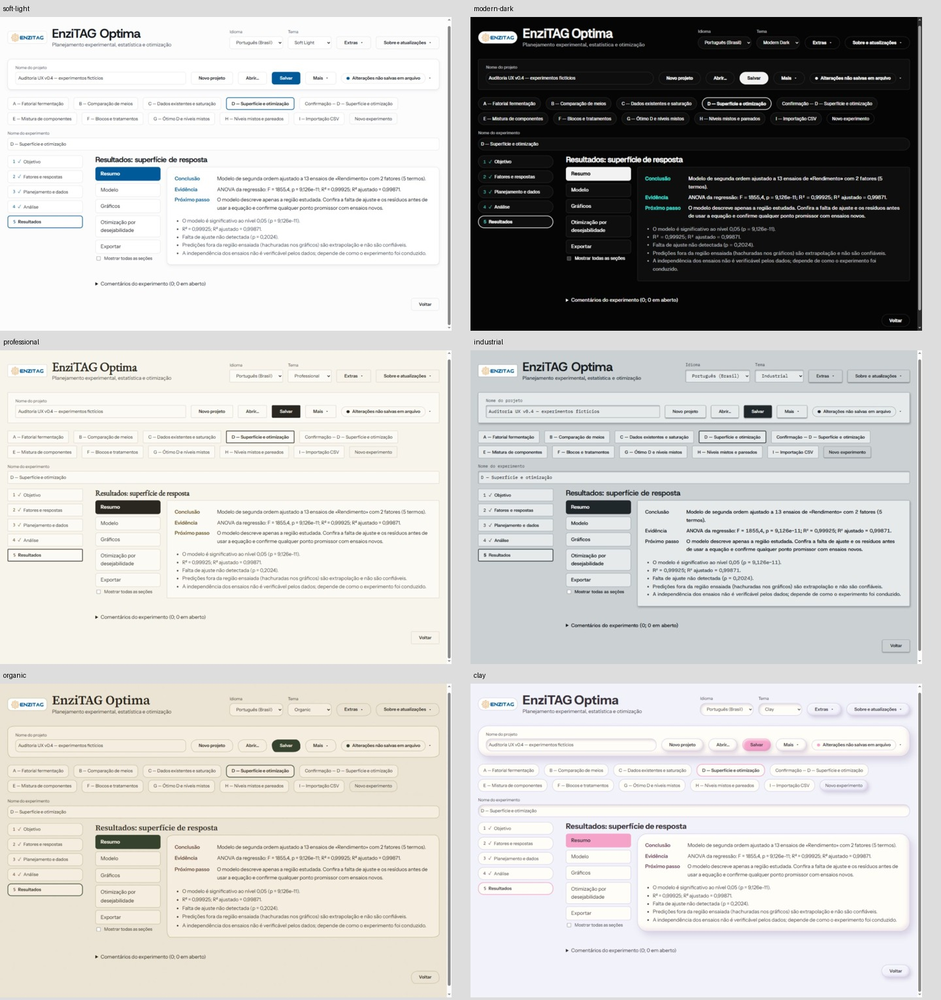
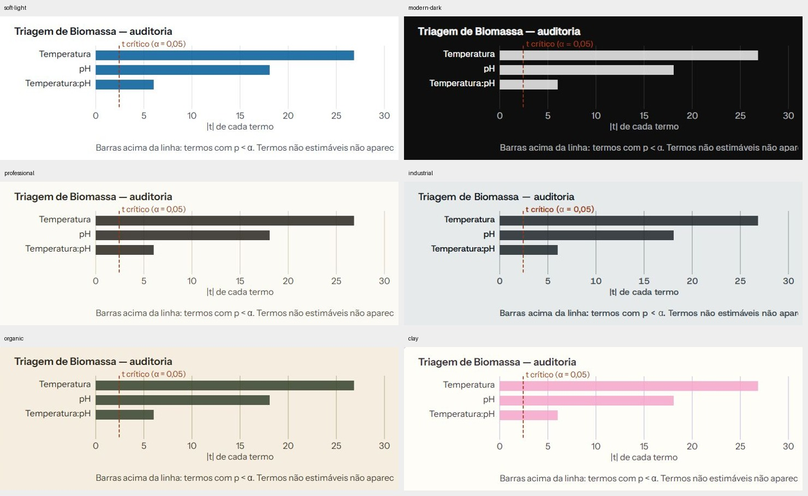
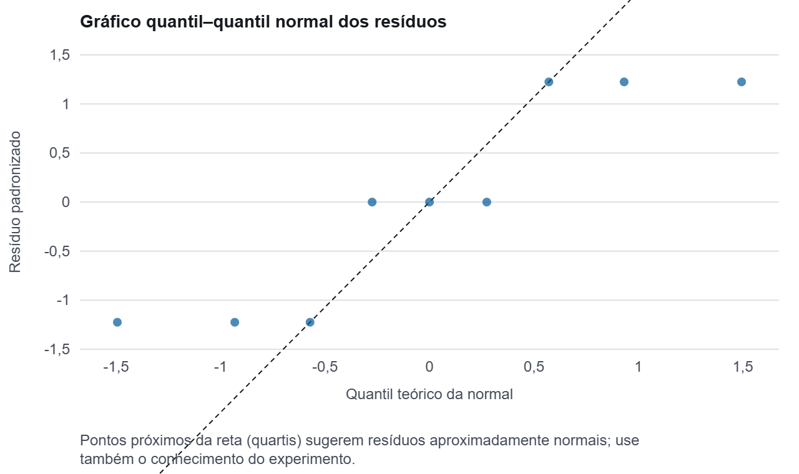
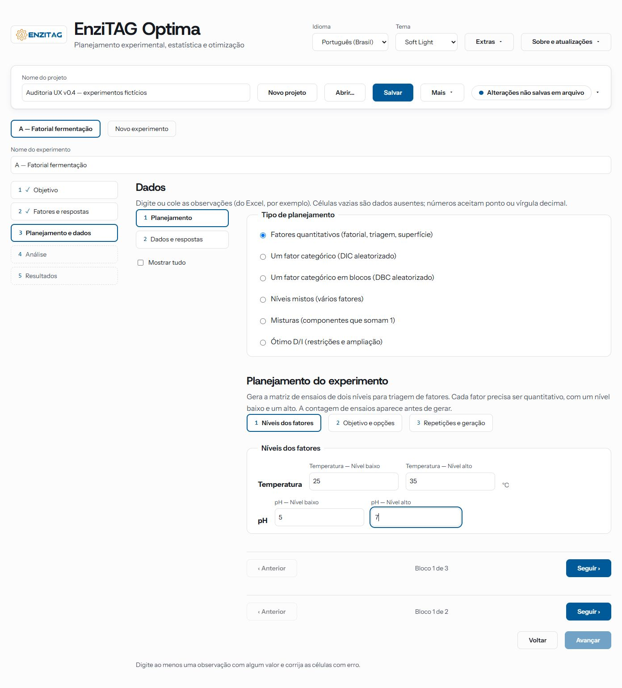
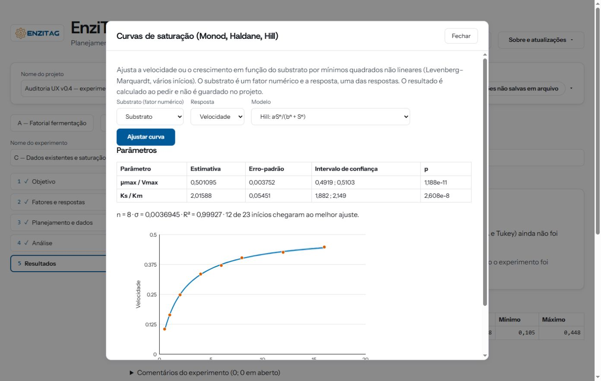
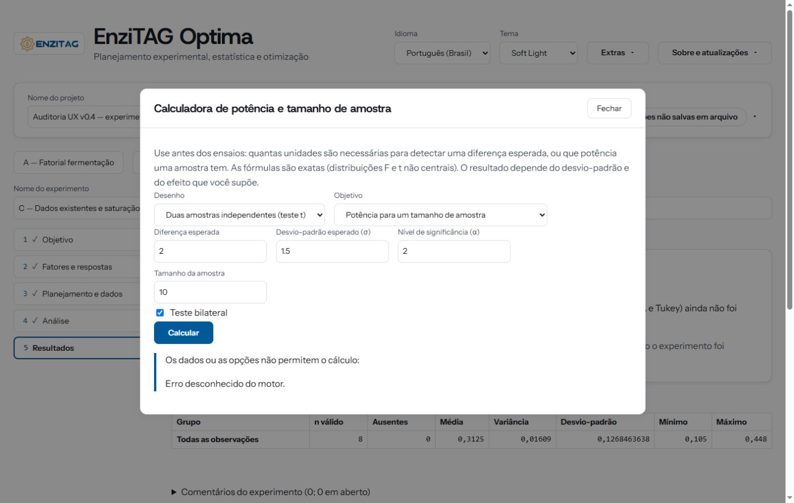
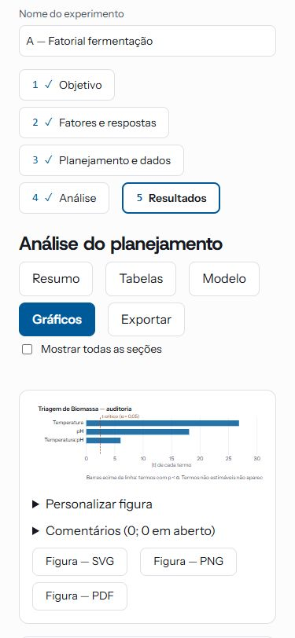

# Auditoria de uso real — EnziTAG Optima, início da v0.4

**Data:** 2026-11-02, horário de Brasília. **Atualização:** revisão de UI design dos seis temas e das figuras científicas, na mesma data. **Natureza:** auditoria exploratória de experiência de uso, apresentação e comunicação dos resultados. **Destino:** complemento ao [plano da v0.4](plano-v0.4.md), à [ET29](ativos/et29-reorganizacao-da-interface-e-navegacao.md) e ao acabamento da ET27.

## Como usar este documento

1. **Experiência por página/bloco:** [seção 4](#4-notas-por-página-e-bloco), UX01–UX50 — problemas observados nos percursos reais.
2. **Base visual comum:** [seção 5](#5-sistema-visual-tipografia-espaçamento-e-apresentação), DS01–DS14 — tipografia, justificado, padding, botões, tabelas e excesso de texto.
3. **Cada tema separadamente:** [seção 6](#6-revisão-individual-dos-seis-temas), TM01–TM06 — preservar identidade e corrigir seus incômodos específicos.
4. **Cada família de figura:** [seção 7](#7-figuras-científicas-revisão-por-família), FG01–FG15 — eixos, legendas, intervalos, cores, layout e arquivos exportados.
5. **Organização para o executor:** [seção 8](#8-organização-consolidada-para-implementação) — frentes, dependências e referências cruzadas para evitar correções duplicadas.
6. **Reprodução e conferência:** seções 9–11; evidências na seção 12 e nos índices de imagens.

**Leitura por responsabilidade:** quem trata navegação começa em UX08/DS06; tipografia e espaços, em DS01–DS05; cada tema, na sua ficha TM; gráficos, nas fichas FG. Os grupos da seção 8 não substituem as observações detalhadas. As prioridades expressam impacto no uso, não uma ordem rígida de arquivos a editar.

## 1. Escopo e interpretação das notas

O aplicativo foi usado de verdade em **http://127.0.0.1:4173/**, no navegador deste computador. Foram criados **nove experimentos manualmente do zero (A–I)** e um décimo pela função de propor ensaios de confirmação. A interação passou pelos controles visíveis: cadastro, colagem, importação, geração de matrizes, cálculos, mudança de modelos, gráficos, otimização, exportação, salvamento e reabertura. Não foram injetados projetos ou resultados pelo código da aplicação.

Todos os dados usados são **fictícios**, preparados apenas para explorar a interface. Os resultados numéricos abaixo identificam o que aconteceu nos testes; não constituem validação científica independente dos métodos.

O repositório local estava em `feat/v0.4`, HEAD `4e60b4c7e43561251e95a05ca685a2dd799aaec9`. Isso identifica a fonte local consultada para contextualizar o plano, **não prova qual commit produziu os arquivos servidos**. O menu Motor científico mostrou motor 0.3.0, protocolo 1 e esquema 1; o relatório também se identifica como app 0.3.0. Não foi recompilado ou substituído o app durante a auditoria. Há diferenças entre requisitos/checklists da ET29 e o comportamento visível; elas são registradas sem atribuir uma causa não investigada.

O documento reúne **85 fichas de observação/recomendação**: 50 de uso (**UX01–UX50**), 14 de sistema visual (**DS01–DS14**), seis de temas (**TM01–TM06**) e 15 de figuras/exportação (**FG01–FG15**). Elas misturam defeitos reproduzidos, dificuldades de descoberta e oportunidades de apresentação; não representam 85 falhas funcionais. Prioridades sugeridas:

- **P1:** pode induzir uma leitura incorreta do resultado, esconder uma exclusão importante ou impedir uma recuperação compreensível.
- **P2:** prejudica orientação, descoberta, leitura ou eficiência de um fluxo frequente.
- **P3:** acabamento, conveniência ou refinamento de comunicação.

As recomendações descrevem **o resultado desejável para o usuário**. O agente executor pode reorganizar páginas, componentes e interações e propor soluções melhores; esta auditoria não impõe biblioteca, estrutura interna, desenho fechado ou implementação mínima.

## 2. Evidências e cobertura

- [77 screenshots da primeira rodada](../imagens/auditoria-ux-v0.4-2026-11-02/README.md), com capturas de página inteira e de área visível. Os nomes são descritivos; uma captura de página inteira não representa tudo visível simultaneamente na tela.
- [Revisão visual adicional: 74 capturas originais, 15 comparativos e medidas](../imagens/auditoria-ux-v0.4-2026-11-02/revisao-design/README.md). São **151 capturas originais nas duas rodadas**, sem contar os comparativos derivados.
- [Projeto usado na auditoria](evidencias-auditoria-v0.4-2026-11-02/auditoria-ux-v0.4.enzitag), salvo pela interface e reaberto pela interface, contendo os dez experimentos.
- [CSV sintético importado](evidencias-auditoria-v0.4-2026-11-02/importacao-sintetica.csv).
- Relatórios do experimento A: [HTML](evidencias-auditoria-v0.4-2026-11-02/a-fatorial-fermentacao-relatorio.html), [PDF](evidencias-auditoria-v0.4-2026-11-02/a-fatorial-fermentacao-relatorio.pdf), [Word](evidencias-auditoria-v0.4-2026-11-02/a-fatorial-fermentacao-relatorio.docx).
- [Malha de predições da superfície](evidencias-auditoria-v0.4-2026-11-02/malha-superficie.csv), baixada pelo aplicativo.
- [Visão geral das quatro páginas do PDF](evidencias-auditoria-v0.4-2026-11-02/pdf-visao-geral.jpg).

| Experimento / percurso | Construção e capacidades exercitadas | Resultado observado |
|---|---|---|
| **A — Fatorial fermentação** | Planejar → Temperatura quantitativa em °C e pH → Biomassa em g/L → níveis 25/35 e 5/7 → fatorial completo → duas repetições e três centrais, semente 42 → 11 respostas → interação e curvatura → resultados | Análise executada; três termos ativos e curvatura detectada. Redução manual de modelo e retorno ao completo funcionaram. Gráfico personalizado e relatórios HTML/PDF/Word baixados com seções ativas. |
| **B — Comparação de meios** | Comparar tratamentos → Meio com Controle/Enriquecido/Alternativo → Atividade em U/mL → colagem de nove linhas → Tukey → retorno à análise → Dunnett com Controle | Tukey executado: F(2;6) = 19, p = 0,002536, dois de três pares diferentes. Dunnett também executado. Navegação por resumo, diagnóstico e gráficos experimentada. |
| **C — Dados existentes e saturação** | Analisar dados existentes → Substrato quantitativo e Velocidade → oito observações → resumo → Extras → Monod → Hill | Resumo calculado. Monod ajustado: Vmax ≈ 0,501095, Ks ≈ 2,01588, R² ≈ 0,99927. Hill recalculado pelo botão. Troca de modelo manteve resultado antigo antes do recálculo. |
| **D — Superfície e otimização** | Planejar → dois fatores quantitativos → Rendimento → composto central de face centrada, cinco centrais, semente 42 → 13 respostas → quadrático completo → equações → otimização | Modelo, equações e otimização executados. Busca encontrou candidatos viáveis. Gráficos de contorno e superfície abertos; malha 61 × 61, controles de rotação/elevação e download de malha experimentados. |
| **Confirmação de D** | Propor ensaios de confirmação → candidato 1, duas repetições → inserir 81,1 e 82,5 | Novo experimento criado com condições e previsões; tabela distinguiu observações em relação ao intervalo previsto. |
| **E — Mistura de componentes** | Três fatores quantitativos → mistura Glicose/Glicerol/Sacarose → lattice grau 2, duas repetições, semente 42 → 12 respostas → quadrático → cúbico especial | Quadrático ajustado, tabela e triângulo exibidos. Cúbico especial mostrou termo não estimável e mensagem com `{{aliased}}` literal. Retornado ao quadrático antes de salvar. |
| **F — Blocos e tratamentos** | Tratamento A/B/C e Dia D1/D2/D3 → DBC → nove respostas → ANOVA multifatorial aditiva com bloco → contraste `1;−0,5;−0,5` | Geração e análise executadas; resumo identificou Dia e Tratamento como significativos. Tabelas e contraste acessados. |
| **G — Ótimo D e níveis mistos** | Temperatura quantitativa + Enzima categórica E1/E2/E3 → tentativa de níveis mistos → ótimo D quadrático de um fator, 25–35, seis ensaios, semente 42 → usar nos dados | Níveis mistos recusou configuração por falta de níveis elegíveis. Ótimo buscou seis ensaios entre três candidatos numéricos; categoria Enzima não entrou e ficou vazia na grade. **Sem respostas/análise neste experimento**; a entrega verificada é a matriz aplicada. |
| **H — Níveis mistos e pareados** | Condição Antes/Depois e Unidade U1–U4 → níveis mistos, uma repetição, semente 42 → oito respostas → pareados → descoberta e preenchimento da coluna Unidade experimental → modelo misto | Primeira tentativa de pareamento falhou por identificação diferente nas unidades geradas. Após preencher a coluna correta, quatro pares analisados: diferença Antes−Depois = −3,5, p(t) = 0,0001101 e p(Wilcoxon) = 0,125. Modelo misto com Condição fixa e intercepto aleatório por unidade executou. |
| **I — Importação CSV** | Analisar dados existentes → resposta inicial Biomassa → importar CSV com Grupo/Biomassa/Tempo → corrigir papéis sugeridos → resumo por Grupo | Separador `;` detectado; vírgula decimal aceita. Quatro de cinco respostas válidas, uma ausente; médias Controle = 1,3 e Tratado = 2,25. Projeto salvo e reaberto. |
| **Extras — potência** | Tamanho de amostra com diferença 1, σ 1,5, α 0,05, potência 0,8 → mudar diferença para 2 → potência para n = 10 → α inválido = 2 | Primeiro cálculo: 37 por grupo, total 74, potência 0,8076. Segundo objetivo calculado. Entrada inválida gerou erro genérico. |

**Outras inspeções:** formulário de DIC (sem gerar uma matriz separada); “Mostrar tudo” em variáveis e “Mostrar todas as seções” em resultados; painel de salvamento e menu do Drive desconectado; menu Motor científico; comentários sem publicar uma nota; menu Extras por Enter/Escape; amostra de gráficos em PT/EN e nos seis temas; layouts em 375, 800, 1200 e 1920 px. Não foi uma matriz exaustiva de todos os cruzamentos de tela × idioma × tema × largura.

### Dados sintéticos para reproduzir

**A:** respostas na ordem aleatorizada da matriz gerada com semente 42: `6,2; 7,3; 6,8; 7,0; 4,9; 5,1; 7,5; 9,2; 6,0; 7,4; 9,0`.

**B:** Controle = `10, 11, 9`; Enriquecido = `15, 16, 14`; Alternativo = `12, 13, 11`.

**C:** pares Substrato/Velocidade: `(0,5;0,105), (1;0,164), (2;0,248), (4;0,335), (6;0,371), (8;0,403), (12;0,426), (16;0,448)`.

**D:** respostas geradas por `80 + 5x + 3z − 8x² − 6z² + 2xz + ε`, com `x=(Temperatura−30)/5`, `z=pH−6` e ε repetindo `−0,3; 0; +0,3` na ordem de execução.

**E:** `10a + 15b + 12c + 8ab + 4ac + 6bc + ε`, com ε alternando `−0,15; +0,15` na ordem de execução. **F:** bases A=60, B=70, C=75, efeitos de dia −3/0/+3 e ε alternando −0,5/+0,5. **H:** Antes = `10+2u`; Depois = `10+2u+3+0,2u`, para unidades u=1…4.

## 3. O que vale preservar

A separação das cinco etapas e os nomes de fatores/respostas tornam o percurso reconhecível. A colagem de várias linhas funcionou sem preparação especial. A validação de `abc` numa resposta explicou o erro junto da célula e bloqueou a análise; ponto e vírgula decimal foram aceitos. A geração com semente registrada e a contagem de ensaios ajudam a revisar a proposta. O DBC levou tratamento e bloco para a configuração de análise. O resumo dos resultados inclui ressalvas úteis sobre independência e confirmação. A personalização gráfica reapareceu depois de reabrir o projeto. O item ativo dos resultados ficou legível no tema escuro. O PDF testado contém resultados e figuras, com proveniência no fim.

Esses comportamentos devem ser preservados ao redesenhar a experiência.

## 4. Notas por página e bloco

### 4.1 Cabeçalho, abertura e gestão do projeto

| ID / prioridade | Observação e efeito para quem usa | Recomendação aberta ao executor | Evidência |
|---|---|---|---|
| **UX01 · P2** | A sessão é apresentada como início da v0.4, mas o motor e o relatório mostram 0.3.0 e não há identificação clara da compilação da interface. Fica difícil saber se uma diferença do plano é comportamento pendente, decisão alterada ou arquivo servido antigo. | Tornar a identidade da versão em teste fácil de consultar, distinguindo interface, motor e compilação. Rever o alinhamento entre o que o plano marca entregue e o comportamento efetivamente exposto. | [Motor](../imagens/auditoria-ux-v0.4-2026-11-02/34-sobre-motor.jpg), PDF e ET29 |
| **UX02 · P2** | A tela inicial mantém três cartões selecionáveis e um “Avançar” abaixo. Em largura menor o usuário precisa selecionar um cartão e procurar outra ação. O requisito inicial de uma ação de começar por opção não aparece nessa sessão. | Dar a cada intenção uma ação imediata, com destino claro; manter abertura de projeto evidente. Resolver a divergência de escopo da T07 de forma explícita, considerando a experiência observada. | [Início](../imagens/auditoria-ux-v0.4-2026-11-02/01-inicio.jpg) |
| **UX03 · P3** | Os três cartões repetem “Disponível nesta versão”, informação que não ajuda a distinguir as escolhas. O bloco de recentes vazio também ocupa espaço relevante com explicação longa. | Priorizar diferenças entre objetivos, exemplos curtos de entrada/saída e a ação de começar. Simplificar estados vazios e oferecer uma primeira experiência compreensível com dados de exemplo, se apropriado. | Início |
| **UX04 · P2** | A área de arquivo continua separada do cabeçalho. “Mais” é o caminho para descobrir Drive; o texto do menu não antecipa isso. O usuário encontra a explicação de download apenas depois de abrir esse menu. | Organizar as ações de arquivo com destinos explícitos e descoberta direta de computador/Drive, preservando a compactação já alcançada. Evitar que uma ação principal dependa de um rótulo genérico. | [Menu](../imagens/auditoria-ux-v0.4-2026-11-02/16-menu-arquivo-dark.jpg) |
| **UX05 · P2** | Depois de baixar o projeto, o indicador diz “Sem alterações pendentes”; só os detalhes explicam que foi um download e que a recuperação automática está desligada. Para um iniciante, isso pode parecer salvamento contínuo do mesmo arquivo. | Comunicar de forma curta onde e quando existe uma cópia recuperável e o que uma edição seguinte exige. Distinguir arquivo baixado, recuperação local e vínculo com Drive sem empilhar mensagens permanentes. | [Detalhes de salvamento](../imagens/auditoria-ux-v0.4-2026-11-02/60-salvamento-detalhes.jpg) |
| **UX06 · P2** | Com dez experimentos, os botões passam a ocupar várias linhas e o campo do nome repete o título do experimento selecionado. Em 375 px esse conjunto empurra muito o conteúdo principal para baixo. | Projetar a gestão de vários experimentos com identificação clara do ativo, busca/seleção eficiente e relação visível entre original e confirmação. A solução pode mudar conforme o espaço disponível. | [375 px](../imagens/auditoria-ux-v0.4-2026-11-02/61-mobile-375-graficos.jpg) |
| **UX07 · P3** | O arquivo foi salvo enquanto I estava ativo e, ao abrir, A foi selecionado. Os dez experimentos continuaram acessíveis, mas o contexto de trabalho não foi retomado. | Oferecer retomada previsível do experimento e do ponto de trabalho, ou explicar a escolha inicial na reabertura. Evitar que o usuário interprete a mudança de contexto como perda de trabalho. | Projeto salvo/reaberto; A mostrado após Abrir |

### 4.2 Navegação entre etapas e blocos

| ID / prioridade | Observação e efeito | Recomendação | Evidência |
|---|---|---|---|
| **UX08 · P2** | Em planejamento aparecem a navegação das etapas, a dos blocos Planejamento/Dados, uma terceira navegação de configuração e dois pares “Anterior/Seguir”, além de “Voltar/Avançar”. Há dois contadores “Bloco n de m” com escopos diferentes. | Tornar cada transição inequívoca e reduzir a competição entre ações. A pessoa deve prever o próximo conteúdo pelo rótulo e pela posição da ação, sem precisar entender o aninhamento interno. | [Níveis](../imagens/auditoria-ux-v0.4-2026-11-02/04-planejamento-niveis.jpg), [opções](../imagens/auditoria-ux-v0.4-2026-11-02/05-planejamento-opcoes.jpg) |
| **UX09 · P2** | Em Fatores, a instrução para liberar “Avançar” pede uma resposta, embora Respostas esteja escondida no outro bloco. No planejamento, o aviso sobre digitar observações surge antes de o usuário sequer gerar a matriz. | Relacionar bloqueios à ação que pode ser feita agora e levar diretamente ao requisito ausente. Diferenciar orientação do próximo passo de mensagens de erro. | [Fatores](../imagens/auditoria-ux-v0.4-2026-11-02/02-fatores.jpg), Níveis |
| **UX10 · P3** | “Mostrar tudo” duplica títulos como “Fatores / Fatores” e “Respostas / Respostas”. A preferência se propagou de variáveis para dados, mudando também a forma de navegar na etapa seguinte. | Manter uma hierarquia única e legível na visão completa e tornar compreensível o alcance da preferência. A visão guiada e a completa devem comunicar o mesmo conteúdo sem repetição estrutural. | [Títulos duplicados](../imagens/auditoria-ux-v0.4-2026-11-02/51-mostrar-tudo-titulos-duplicados.jpg) |
| **UX11 · P2** | Ao voltar da análise para dados gerados, reaparece o bloco Planejamento; para corrigir a unidade foi necessário procurar novamente Dados e respostas. Em resultados completos a página volta a ser muito longa. | Preservar ou escolher contexto útil ao retorno, com atalhos para o bloco a corrigir e orientação persistente em conteúdos extensos. Evitar obrigar a pessoa a repetir uma navegação já percorrida. | Fluxo H; [todas as seções](../imagens/auditoria-ux-v0.4-2026-11-02/73-resultados-mostrar-todas.jpg) |

### 4.3 Fatores e respostas

| ID / prioridade | Observação e efeito | Recomendação | Evidência |
|---|---|---|---|
| **UX12 · P2** | Todo fator novo começa categórico. Para dois fatores numéricos foi preciso trocar o tipo repetidamente; o usuário só descobre as exigências do método mais adiante. | Usar a intenção do experimento para orientar os tipos e explicar o impacto da escolha, mantendo liberdade de edição. A pessoa deve perceber cedo se está cadastrando componentes, tratamentos ou variáveis numéricas. | Fatores; experimentos A/D/E |
| **UX13 · P3** | Os cartões têm rótulos repetidos “Nome”, “Tipo”, “Unidade” e “Remover”, com pouco contexto na própria ação. Em listas maiores, a identificação fica dependente de acompanhar o cartão certo. | Dar contexto claro a cada item e às ações que o afetam, inclusive por teclado/leitor de tela; favorecer revisão rápida do conjunto e edição sem confundir fator e resposta. | Fatores e [Respostas](../imagens/auditoria-ux-v0.4-2026-11-02/03-respostas.jpg) |
| **UX14 · P2** | Níveis mistos pede voltar e digitar níveis no campo “Níveis”. Esse campo não aparece quando o fator é Quantitativo; Temperatura numérica + Enzima categórica não foi elegível, embora a ferramenta diga que aceita fatores numéricos como níveis nomeados. | Tornar viável e descoberta a definição de níveis discretos de fatores numéricos. Explicar a relação entre tipo da variável, níveis do planejamento e tratamento na análise. Não deixar a orientação apontar para um campo inacessível naquela configuração. | [Orientação de níveis mistos](../imagens/auditoria-ux-v0.4-2026-11-02/47-niveis-mistos-orientacao.jpg) |

### 4.4 Escolha do planejamento, opções e geração

| ID / prioridade | Observação e efeito | Recomendação | Evidência |
|---|---|---|---|
| **UX15 · P2** | A família de planejamento é escolhida depois do cadastro de fatores. Aparecem todas as famílias como opções equivalentes; só depois de escolher surgem restrições de elegibilidade. | Apoiar a decisão pelo problema experimental e pela configuração existente. Tornar visíveis compatibilidade, exigências e o que cada família entrega antes de exigir uma ida e volta entre etapas. | Níveis; DBC; Misturas |
| **UX16 · P2** | Ao escolher superfície de resposta, a introdução do painel ainda diz que gera matriz de dois níveis para triagem. A escolha circunscrito/inscrito explica ±α, mas não apresenta de imediato os extremos reais que serão executados. | Adaptar a explicação à família escolhida e ajudar a conferir os níveis reais, especialmente quando pontos axiais extrapolam os níveis informados. Mostrar as consequências operacionais antes de gerar. | [Superfície — opções](../imagens/auditoria-ux-v0.4-2026-11-02/35-superficie-opcoes.jpg) |
| **UX17 · P3** | Para apenas dois fatores, são oferecidos Plackett–Burman de 8 e 12 ensaios ao lado de fatorial completo de 4. “Recomendado” existe, mas não há contexto imediato para gastar mais ensaios numa triagem tão pequena. | Explicar compromissos de custo, informação e confundimento das alternativas no contexto atual, sem sugerir que todos os métodos listados são igualmente pertinentes. | [Opções de dois fatores](../imagens/auditoria-ux-v0.4-2026-11-02/05-planejamento-opcoes.jpg) |
| **UX18 · P2** | Repetições, centrais e suas explicações ficam muito próximas; duas orientações distintas aparecem como texto corrido. A semente aleatória longa chama atenção parecida à dos parâmetros científicos. | Favorecer uma revisão do total e de sua composição: combinações, repetições independentes e pontos centrais. Dar às opções de reprodutibilidade uma hierarquia compatível com seu uso e tornar clara a diferença entre réplica e repetição de leitura. | [Geração e matriz](../imagens/auditoria-ux-v0.4-2026-11-02/06-matriz-fatorial.jpg) e configuração de D |
| **UX19 · P2** | Depois de gerar o fatorial, aparece a matriz apenas com fatores; as respostas são preenchidas num outro bloco. A transferência entre a matriz e a grade não fica evidente. Em ótimo, “Usar este planejamento nos dados” informa sucesso mas mantém o usuário no painel anterior. | Fazer o percurso proposta → conferência → coleta/preenchimento ficar explícito e oferecer acesso direto à tarefa seguinte, sem exigir que a pessoa descubra onde a matriz passou a ser editável. | Matriz fatorial; [ótimo](../imagens/auditoria-ux-v0.4-2026-11-02/49-otimo-resultado.jpg) |
| **UX20 · P1** | O ótimo considerou apenas Temperatura e omitiu Enzima categórica, sem explicação de exclusão no painel. A grade resultante manteve uma coluna Enzima vazia. Isso permite levar ao laboratório uma proposta incompleta para a configuração cadastrada. | Explicitar os fatores efetivamente usados e os excluídos, a razão e a forma de resolver a situação. A aplicação da proposta precisa deixar claro o que acontecerá com todas as colunas cadastradas e com a análise subsequente. | [Ótimo — categoria omitida](../imagens/auditoria-ux-v0.4-2026-11-02/48-otimo-fator-categorico-omitido.jpg), [grade](../imagens/auditoria-ux-v0.4-2026-11-02/50-otimo-grade-com-categoria-vazia.jpg) |

### 4.5 Grade de dados, importação e identificação das unidades

| ID / prioridade | Observação e efeito | Recomendação | Evidência |
|---|---|---|---|
| **UX21 · P2** | A grade apresenta muitos campos individuais e um “Remover linha” por observação; o cabeçalho da coluna de ações é “Planejamento e dados”. Há pouca diferenciação visual entre condições geradas e respostas a preencher. | Favorecer leitura e preenchimento como tarefa de coleta, com papéis de coluna claros, ações secundárias discretas e referência estável do ensaio. Dar segurança ao editar uma condição gerada e mostrar quando isso altera a proposta original. | [Dados colados](../imagens/auditoria-ux-v0.4-2026-11-02/17-comparacao-dados-colados.jpg), grade de G |
| **UX22 · P2** | A validação de `abc` funcionou e explicou o erro. Porém o resumo global “1 célula(s) com erro” não oferece um caminho evidente para localizar erros quando a grade cresce. | Preservar a boa explicação junto da célula e ampliar a orientação para grades longas: localizar pendências e distingui-las de valores ausentes intencionais. | [Validação](../imagens/auditoria-ux-v0.4-2026-11-02/07-dados-validacao.jpg) |
| **UX23 · P1** | Na importação de Grupo/Biomassa/Tempo, com Biomassa já cadastrada como resposta, a sugestão fez Biomassa virar fator e Tempo virar resposta. A prévia exigiu correção manual. Uma confirmação sem revisão analisaria outra variável. | Melhorar a correspondência com o contexto existente e fazer o resumo do mapeamento destacar qual é a resposta, quais colunas serão criadas/substituídas e quais suposições foram feitas. Exigir compreensão do resultado da importação, sem confiar numa escolha silenciosa da última coluna. | [Prévia](../imagens/auditoria-ux-v0.4-2026-11-02/58-importacao-previa.jpg) |
| **UX24 · P2** | O caminho “Analisar dados existentes” exige cadastrar uma resposta antes de liberar a tela que importa e redefine as colunas. A importação aparece dentro de uma página já preenchida com outros controles e uma grade vazia. | Permitir que a entrada por arquivo seja um início natural e que o cadastro resulte da revisão das colunas. Distinguir claramente importar dados livres de preencher respostas da matriz de coleta, com resumo do que será preservado. | Fluxo I e Prévia |
| **UX25 · P1** | Um fator chamado Unidade não é a coluna de Unidade experimental usada no pareamento. A coluna correta está escondida em Opções avançadas e tinha identificadores distintos por condição. O erro pede “informe a unidade”, mas não conduz ao controle; o painel fala em coluna “Unidade”, diferente do título da grade. | Fazer o papel da unidade experimental ser explícito e selecionável a partir dos dados existentes, sem confundir nome da coluna e função. No pareamento, mostrar quantidade de unidades, pares completos/incompletos e como corrigir o vínculo. | [Primeira tentativa](../imagens/auditoria-ux-v0.4-2026-11-02/54-pareados-sem-papel-unidade.jpg), [duas colunas](../imagens/auditoria-ux-v0.4-2026-11-02/55-pareados-duas-colunas-unidade.jpg) |

### 4.6 Configuração das análises

| ID / prioridade | Observação e efeito | Recomendação | Evidência |
|---|---|---|---|
| **UX26 · P1** | A introdução de comparação continua descrevendo DIC/Tukey mesmo no DBC multifatorial e após selecionar Dunnett. O texto de α continua dizendo “família de todas as comparações de pares” no procedimento contra controle. | Alinhar a explicação, as hipóteses e a família de inferência ao método efetivamente selecionado. O resumo anterior ao cálculo deve dizer o que será comparado e sob qual modelo. | [Dunnett](../imagens/auditoria-ux-v0.4-2026-11-02/23-dunnett-textos.jpg), [DBC](../imagens/auditoria-ux-v0.4-2026-11-02/45-dbc-analise-contraste.jpg) |
| **UX27 · P2** | Na comparação de um único fator categórico, “Fator que define os grupos” começou em “—” e o botão ficou desabilitado. A pessoa já havia escolhido comparar tratamentos e só tinha Meio como candidato. | Reduzir escolhas redundantes quando houver uma única opção inequívoca e explicar qualquer bloqueio remanescente junto da ação. Preservar edição explícita quando houver ambiguidade real. | [Análise de comparação](../imagens/auditoria-ux-v0.4-2026-11-02/18-comparacao-analise.jpg) |
| **UX28 · P2** | Contrastes pedem coeficientes numa lista textual, mas a ordem dos níveis não fica exposta junto dos coeficientes. A etapa mistura resposta, método, blocos, somas de quadrados, contrastes e ferramentas para dependência numa página longa. | Mostrar a correspondência nível ↔ peso durante a edição e traduzir a expressão em uma descrição verificável. Organizar a configuração por decisões e dependências, com um resumo revisável antes do cálculo. | DBC com contraste |
| **UX29 · P2** | Pareados e modelo misto estão num painel abaixo da análise principal de observações independentes. No modelo misto, o fator Unidade também começa marcado como efeito fixo, embora haja intercepto aleatório por unidade. | Orientar primeiro pela estrutura das observações e depois pelos métodos compatíveis. Separar claramente identificação, efeito fixo e agrupamento aleatório; evitar que a escolha padrão convide a representar a mesma unidade de formas confusas. | [Pareados](../imagens/auditoria-ux-v0.4-2026-11-02/56-pareados-resultado.jpg), [misto](../imagens/auditoria-ux-v0.4-2026-11-02/57-modelo-misto.jpg) |

### 4.7 Resultados, tabelas, equações e figuras

| ID / prioridade | Observação e efeito | Recomendação | Evidência |
|---|---|---|---|
| **UX30 · P2** | A análise recém-calculada de B abriu em Exportar, herdando a seção usada em A. Assim, o usuário viu preferências de aparência em vez do resultado que acabou de solicitar. | Distinguir chegada de um cálculo novo de retorno a uma seção já visitada. Expor primeiro o resultado relevante e manter orientação por experimento/análise, sem herdar uma preferência que esconda o cálculo novo. | [Resultado novo em Exportar](../imagens/auditoria-ux-v0.4-2026-11-02/19-novo-resultado-abre-exportar.jpg) |
| **UX31 · P1** | O resumo descritivo afirma que ANOVA/Tukey “ainda não foi entregue”, mesmo tendo sido executado no mesmo app. A instrução de próximo passo comunica uma capacidade falsa e não oferece caminho para comparar grupos. | Revisar mensagens de capacidade em toda a interface e idiomas; fornecer próximos passos que correspondam ao produto atual e ao conjunto de dados, preservando a diferença entre descrição e inferência. | [Descritiva](../imagens/auditoria-ux-v0.4-2026-11-02/26-descritiva-texto-desatualizado.jpg), [importação resumida](../imagens/auditoria-ux-v0.4-2026-11-02/59-importacao-resumo-ausente.jpg) |
| **UX32 · P2** | O resumo repete termos ativos no campo Evidência e na lista. A descritiva usa dez casas no desvio-padrão; a falta de ajuste mostra `0,00000000000000086042` com zero graus de liberdade. Valores relevantes e detalhes numéricos recebem peso parecido. | Criar uma hierarquia entre conclusão, magnitude/incerteza e ressalvas. Uniformizar precisão de apresentação e explicar valores praticamente nulos e testes indisponíveis, mantendo números completos acessíveis quando necessários. | [Resumo](../imagens/auditoria-ux-v0.4-2026-11-02/09-resultados-resumo.jpg), [tabelas](../imagens/auditoria-ux-v0.4-2026-11-02/10-resultados-tabelas.jpg), Descritiva |
| **UX33 · P1** | A equação codificada usa literalmente Temperatura e pH, assim como a de unidades reais. O título distingue escalas, mas copiar a equação com nomes favorece inserir 30 e 6 onde os valores deveriam ser 0 e 0. A transformação só pode ser inferida da tabela mais abaixo. | Tornar impossível confundir variável codificada com medida física. Mostrar a transformação de cada fator junto da equação e oferecer uma forma inequívoca de copiar/usar a expressão escolhida. Preservar a opção de nomes sem sacrificar a identificação da escala. | [Equações](../imagens/auditoria-ux-v0.4-2026-11-02/36-superficie-modelo-equacoes.jpg), [notação](../imagens/auditoria-ux-v0.4-2026-11-02/37-equacao-notacao.jpg) |
| **UX34 · P2** | Efeitos principais e interações usam “baixo/alto” sem exibir 25/35 °C e 5/7 no próprio gráfico. Com texto da figura em 1,2, a nota longa do Pareto pode terminar cortada. A versão em tela estreita reduz o SVG inteiro e deixa rótulos minúsculos. | Dar contexto físico às escalas e garantir legibilidade real, incluindo títulos/notas longos e fontes maiores. Permitir examinar figuras em tamanho útil; não considerar ausência de rolagem horizontal equivalente a boa leitura. | [Gráficos](../imagens/auditoria-ux-v0.4-2026-11-02/12-graficos-fatorial.jpg), [tema escuro](../imagens/auditoria-ux-v0.4-2026-11-02/67-tema-modern-dark.jpg), [375 px](../imagens/auditoria-ux-v0.4-2026-11-02/62-mobile-375-area-visivel.jpg) |
| **UX35 · P3** | Cada figura repete Personalizar, Comentários e três botões de formato. O ajuste de fonte/paleta global fica em Exportar, separado da atividade de visualizar. Nos temas, elementos secundários e a linha crítica têm saliência variável. | Permitir personalização e exportação no contexto certo sem dominar a leitura científica. Esclarecer o alcance global/por figura e testar a leitura de eixos, legendas e referências em cada tema, além da cor do botão ativo. | [Personalização](../imagens/auditoria-ux-v0.4-2026-11-02/13-personalizacao.jpg), capturas 66–69 |

### 4.8 Otimização e confirmação

| ID / prioridade | Observação e efeito | Recomendação | Evidência |
|---|---|---|---|
| **UX36 · P2** | Objetivo, alvo, limite aceitável, expoente, importância e limites obrigatórios aparecem juntos, com explicações extensas. Depois do cálculo vêm mensagens, tabela, gráfico e outra tabela quase igual para confirmação. | Organizar a construção do objetivo por decisões compreensíveis e permitir revisar o significado da desejabilidade antes da busca. Reduzir repetição e facilitar a transição resultado → escolha → ensaio de confirmação. | [Configuração](../imagens/auditoria-ux-v0.4-2026-11-02/38-otimizacao-configuracao.jpg), [resultado](../imagens/auditoria-ux-v0.4-2026-11-02/39-otimizacao-resultados.jpg) |
| **UX37 · P2** | Os cinco candidatos apresentados tinham desejabilidade 1, mas a tabela mantém posições 1…5 e fala em melhor solução. Isso pode parecer uma ordenação por maior Rendimento, embora as previsões difiram e o alvo já sature a desejabilidade. | Explicar empates e platôs do critério, distinguir maior desejabilidade de maior resposta e apresentar informação útil para escolher entre condições equivalentes. Tornar claros o total encontrado e o subconjunto exibido. | Resultado da otimização |
| **UX38 · P2** | A proposta criou corretamente um experimento novo, mas a relação com a análise de origem é comunicada principalmente pelo nome. A tabela de confirmação lista previsto, intervalo e situação sem favorecer tanto a leitura do desvio observado. | Tornar a origem e o retorno à proposta fáceis de identificar e apresentar a comparação observado/previsto com unidade, diferença e interpretação proporcionais à evidência. Manter explícita a limitação de poucos ensaios. | [Confirmação](../imagens/auditoria-ux-v0.4-2026-11-02/40-confirmacao.jpg) |

### 4.9 Misturas

| ID / prioridade | Observação e efeito | Recomendação | Evidência |
|---|---|---|---|
| **UX39 · P2** | Após ajustar a mistura, coeficientes, ANOVA e figura aparecem na própria Análise. Resultados fica desabilitada; em uma passagem chegou a ostentar “concluída” mesmo bloqueada. A navegação não corresponde ao sucesso do cálculo. | Unificar a orientação de configuração e resultado entre famílias. Enquanto a ET22 estiver pendente, o estado transitório precisa ser compreensível e nunca indicar conclusão de uma etapa inacessível. | [Mistura ajustada](../imagens/auditoria-ux-v0.4-2026-11-02/42-misturas-resultado-na-analise.jpg) |
| **UX40 · P1** | Lattice grau 2 com repetição não tem informação para o termo triplo do cúbico especial. O app mostra esse coeficiente como “—”, mas a explicação termina em `{{aliased}}`, sem substituir os termos. | Expor os termos não estimáveis, o motivo e o que pode resolver o problema. Diferenciar claramente modelo solicitado, parte estimável e consequência para predições. Verificar as mensagens equivalentes em PT/EN. | [Cúbico não estimável](../imagens/auditoria-ux-v0.4-2026-11-02/43-mistura-modelo-nao-estimavel.jpg) |
| **UX41 · P2** | O triângulo usa uma área pequena e muita largura fica vazia; a escala mistura “mínimo/máximo” com ponto decimal em PT e a figura não tem o conjunto de ações das figuras de DoE. A etapa de planejar usa proporções sem uma conferência gráfica prévia da região. | Dar ao diagrama ternário espaço e informação suficientes: componentes, frações, região viável, pontos e escala da resposta. Buscar consistência de personalização/exportação e de formatação. A evolução pode acompanhar ET22/ET25 sem ficar limitada à tabela atual. | [Planejamento](../imagens/auditoria-ux-v0.4-2026-11-02/41-misturas-planejamento.jpg), Mistura ajustada |

### 4.10 Extras: saturação e potência

| ID / prioridade | Observação e efeito | Recomendação | Evidência |
|---|---|---|---|
| **UX42 · P1** | Depois de ajustar Monod, selecionar Hill deixa a tabela de dois parâmetros e a curva de Monod visíveis, sem aviso. Só “Ajustar curva” atualiza para Hill. Seletor e resultado parecem referir-se ao mesmo cálculo. | Vincular visualmente cada resultado às entradas/modelo que o produziram e sinalizar imediatamente quando a configuração mudou. Evitar que resultado antigo seja lido como resposta da seleção atual. | [Monod](../imagens/auditoria-ux-v0.4-2026-11-02/27-saturacao-monod.jpg), [Hill com resultado anterior](../imagens/auditoria-ux-v0.4-2026-11-02/28-saturacao-hill-resultado-anterior.jpg) |
| **UX43 · P2** | Saturação apresenta fórmula com a/b/c e parâmetros como μmax/Vmax e Ks/Km; a curva usa nomes sem as unidades cadastradas. A explicação abre com detalhes do algoritmo. Não há encaminhamento equivalente aos relatórios e figuras do fluxo principal. | Priorizar a pergunta experimental, o modelo escolhido e os parâmetros com nomes/unidades coerentes. Oferecer leitura da curva, incerteza e qualidade do ajuste antes dos detalhes do algoritmo. Integrar preservação e exportação com a ET22, mantendo avisos claros enquanto isso não existir. | Monod e [Hill calculado](../imagens/auditoria-ux-v0.4-2026-11-02/29-saturacao-hill.jpg) |
| **UX44 · P1** | Na potência, trocar diferença 1 → 2 ou mudar o objetivo conserva o resultado “37 por grupo, total 74” e a tabela anterior até Calcular. Inserir α=2 e calcular gera “Erro desconhecido do motor”. | Impedir confusão entre cálculo anterior e entradas atuais; validar os domínios dos campos com mensagens orientadas à correção, preservando valores válidos e identificando o campo responsável. Aplicar o mesmo cuidado aos outros desenhos/objetivos. | [Resultado anterior](../imagens/auditoria-ux-v0.4-2026-11-02/31-potencia-resultado-antigo.jpg), [erro genérico](../imagens/auditoria-ux-v0.4-2026-11-02/33-potencia-erro-generico.jpg) |
| **UX45 · P2** | “Tamanho da amostra” não esclarece no campo se n é por grupo ou total; essa distinção só aparece no resultado. O resultado é seguido por uma longa tabela e detalhes de não centralidade. Em 375 px, introdução e título ocupam grande parte do modal. | Explicar a unidade de n e dos efeitos enquanto a pessoa informa os dados. Dar destaque ao número que orienta a decisão e à sensibilidade às suposições; escolher uma visualização que torne a relação n/potência fácil de examinar. Manter detalhes matemáticos acessíveis sem dominar o início. | [Amostra](../imagens/auditoria-ux-v0.4-2026-11-02/30-potencia-amostra.jpg), [375 px](../imagens/auditoria-ux-v0.4-2026-11-02/64-mobile-375-potencia.jpg) |

### 4.11 Exportação, relatórios e comentários

| ID / prioridade | Observação e efeito | Recomendação | Evidência |
|---|---|---|---|
| **UX46 · P2** | Exportar reúne idioma, CSV, figuras e inclusão de comentários/logotipo antes dos botões de relatório. As preferências do dispositivo e as da figura têm locais e persistências distintos. Nem toda família usa a mesma estrutura de resultados. | Tornar previsível o que será exportado, de qual análise e com qual aparência/idioma. Organizar configurações pelo artefato desejado e indicar o alcance das preferências. Favorecer conferência do conteúdo antes de baixar. | [Exportação](../imagens/auditoria-ux-v0.4-2026-11-02/14-exportacao.jpg) |
| **UX47 · P2** | O PDF contém resultados e figuras, mas também instruções da interface: “Desmarque um efeito...” e “o aplicativo recalcula...”, sem haver interação no documento. O título de seleção do modelo termina na página 1 e seu conteúdo continua na 2; a última página fica bastante vazia. | Redigir relatório como documento científico autossuficiente, com identificação do modelo efetivamente usado e metodologia adequada. Revisar paginação, hierarquia e densidade sem perder tabelas, figuras e proveniência. Não tratar o relatório apenas como impressão dos controles. | [PDF — quatro páginas](evidencias-auditoria-v0.4-2026-11-02/pdf-visao-geral.jpg) |
| **UX48 · P3** | Em Comentar sobre, as análises aparecem como “Análise a1 (two_level_design_analysis)”, a2 e a3. Os códigos não ajudam a distinguir os modelos que o usuário criou ao reduzir/restaurar termos. | Nomear os alvos de comentário com informações reconhecíveis: método, resposta, modelo/revisão e momento. Manter identificadores internos disponíveis para rastreabilidade sem usá-los como principal descrição. | [Comentários](../imagens/auditoria-ux-v0.4-2026-11-02/71-comentarios-identificadores.jpg) |

### 4.12 Uso em telas menores e acessibilidade de leitura

| ID / prioridade | Observação e efeito | Recomendação | Evidência |
|---|---|---|---|
| **UX49 · P2** | Em 375 px, nome, vários experimentos e botões das cinco etapas consomem muitas telas antes da análise. Os botões de etapa se distribuem em linhas; não há o seletor compacto descrito no plano. As tabelas têm largura maior que a área visível e exigem rolagem local. | Priorizar a tarefa atual no espaço disponível e oferecer acesso compacto ao contexto e às etapas. Nas tabelas, tornar perceptível a continuação horizontal e preservar referências de linhas/colunas durante a leitura. Medir conforto de uso, além de overflow da página. | [Área visível](../imagens/auditoria-ux-v0.4-2026-11-02/62-mobile-375-area-visivel.jpg), [tabelas](../imagens/auditoria-ux-v0.4-2026-11-02/63-mobile-375-tabelas.jpg), [800 px](../imagens/auditoria-ux-v0.4-2026-11-02/65-tablet-800-tabelas.jpg) |
| **UX50 · P2** | Nos modais de Extras há rolagem interna e a página de fundo também apresenta barra de rolagem. Em 375 px o cabeçalho da calculadora ocupa várias linhas, opções compridas ficam cortadas e é preciso descer bastante até a ação. | Tratar as ferramentas como tarefas completas em espaços pequenos: título conciso, entrada e ação fáceis de alcançar, resultado legível e uma estratégia clara de rolagem/foco. Verificar teclado e ampliação de texto em todo o percurso. | Potência em 375 px; Monod |

## 5. Sistema visual: tipografia, espaçamento e apresentação

Esta revisão de UI design complementa as notas UX01–UX50. **DS** identifica regras comuns de apresentação; **TM**, o acabamento de cada tema; **FG**, cada família de figura e a exportação. Não são três listas alternativas: aplicar os fundamentos comuns, preservar a identidade do tema e conferir a figura correspondente. As referências a UX evitam transformar o mesmo problema em tarefas duplicadas.

### Método da revisão visual

Foram percorridos os **seis temas**, com a mesma base de dados e uma janela comparável de **1440 × 1000 px**. Em cada tema foram capturados resumo, tabelas, figuras fatoriais, diagnóstico de Tukey, médias brutas e marginais, superfície, misturas, formulário de fatores, modal de saturação, modal de potência e desejabilidade. Isso cobre **13 famílias de figura**, contando observado × predito como uma família, mesmo quando aparece em duas análises. O gráfico de potência não existe nesta amostra: a ferramenta apresenta resultado e tabela; não foi tratado como uma figura já implementada.

O experimento B foi recalculado temporariamente com Tukey para obter as figuras de diagnóstico e devolvido a Dunnett ao fim da revisão. A mistura e Monod foram recalculados porque seus resultados não reaparecem guardados no projeto. O arquivo original da auditoria não foi sobrescrito. As recomendações não dependem de alterar os dados fictícios.

As [capturas novas, comparativos e medidas](../imagens/auditoria-ux-v0.4-2026-11-02/revisao-design/README.md) se somam às 77 capturas anteriores. Os comparativos são recortes das capturas originais, identificados por tema; não são propostas de redesign. A leitura de contraste aqui é uma avaliação visual dirigida, **não uma nova certificação de acessibilidade**. Foram também conferidos PNGs exportados em Dark/Clay e Q–Q em Soft Light.

**Contexto de produto preservado:** a [DT-0021](../decisoes-tecnicas/dt-0021-temas-adicionais-fontes-e-logo.md) define que as figuras na tela acompanham o tema e as exportadas usam cores próprias e fundo branco. Os PNGs testados confirmam essa normalização. Os pares de texto do tema e o uso restrito dos acentos já têm decisões documentadas; esta revisão não recomenda trocar uma cor legível por uma cor decorativa para reforçar identidade.

### DS01 · P2 — Hierarquia tipográfica e peso óptico

**Onde:** cabeçalho, títulos de etapa, conclusões, rótulos e tabelas; complementa UX32 e UX35.

**Observado:** no resumo, o título de etapa tem 24 px/700 e 28,8 px de entrelinha. O corpo tem 16 px/400 e 25,6 px de entrelinha, ou 27,2 px no Organic. Mesmo com peso nominal 400, Geist no Dark e Host Grotesk no Industrial parecem mais densos nas capturas; o mesmo primeiro parágrafo ocupa duas linhas nesses temas e uma nos demais. Igualar números de CSS não iguala a aparência das fontes.

**Recomendar:** definir papéis reconhecíveis de título, subtítulo, rótulo, resultado e ajuda; ajustar tamanho, peso e largura pelo resultado óptico de cada família. Manter números de tabelas e eixos fáceis de distinguir. Reservar negrito para o que orienta a decisão; dados de igual importância não devem parecer títulos. Os títulos serifados podem precisar de compensação óptica, sem obrigar todos os temas a usar a mesma fonte.

**Conferir:** a pessoa identifica primeiro o nome da análise e seu resultado principal, depois as opções e ressalvas. A troca de tema não cria títulos aparentemente menores que rótulos nem transforma toda a página em texto pesado.

### DS02 · P2 — Alinhamento, justificado e largura de leitura

**Onde:** introduções, ajuda de formulários, conclusão e relatório; complementa UX03, UX28, UX32 e UX47.

**Observado:** o app alinha texto à esquerda/início; o desconforto vem principalmente de linhas longas, repetições e blocos com largura pouco adequada ao conteúdo. No resumo há margem direita irregular e uma coluna fixa de rótulos; justificar tudo não resolveria esses problemas e criaria espaçamentos grandes em colunas estreitas.

**Recomendar:** manter alinhamento inicial em controles, mensagens curtas, listas e legendas; alinhar números de tabelas de modo consistente e nomes à esquerda. Limitar a largura dos parágrafos longos e revisar a redação antes de justificar. Para texto corrido de relatório, avaliar justificado somente em coluna adequada, com hifenização PT/EN e revisão de rios de espaço; não estender automaticamente a regra à interface. Equações, unidades e números exigem suas próprias quebras.

**Conferir:** palavras não ficam artificialmente separadas, as linhas se percorrem com facilidade e a última linha de um bloco não vira um fragmento isolado. Nenhuma instrução depende de alinhamento central para se destacar.

### DS03 · P2 — Padding interno e ritmo vertical

**Onde:** painéis, fieldsets, cartões de figura e modais; complementa UX08, UX10 e UX50.

**Observado:** o painel da conclusão já tem **24 px de padding** nos seis temas, uma base confortável. Em contrapartida, outras regiões colocam introdução, rótulos e ação muito próximos, enquanto os formulários deixam grandes áreas para ações secundárias. Acrescentar padding indiscriminadamente alongaria ainda mais a página.

**Recomendar:** criar relações previsíveis entre rótulo/campo/ajuda, itens de um grupo e grupos diferentes. Como ponto de partida de design, avaliar 4–8 px entre rótulo e campo, 8–12 px entre controles irmãos, 16–24 px entre grupos e 24–40 px entre seções; ajustar por densidade, tema e largura. Esses valores são sugestões de partida, não medições de todos os componentes nem contrato de implementação. Em telas pequenas, reduzir a moldura antes de reduzir a fonte.

**Conferir:** elementos que pertencem à mesma decisão parecem próximos; seções diferentes têm uma pausa clara. A borda arredondada não invade texto, foco ou conteúdo da figura.

### DS04 · P2 — Espaçamento dos botões e alinhamento de grupos

**Onde:** arquivo, ações de tabela/figura, geração e navegação; complementa UX04, UX08, UX19 e UX35.

**Observado:** botões de seções têm padding 8 × 16 px, altura aproximada de 43,6 px — 45,2 px no Organic — e raio de 8 px. Rótulos longos como “Otimização por desejabilidade” dobram a altura. Botões de formato e comentários se repetem sob cada figura; os grupos não deixam sempre evidente qual ação é principal.

**Recomendar:** alinhar controles irmãos pela mesma referência e espaçar mais grupos com finalidades diferentes. Nas quebras, manter cada rótulo completo e legível, sem comprimir a fonte ou deixar uma única ação órfã em outra linha. O usuário deve distinguir navegar, executar e baixar. Rever a geometria dos botões de seção em relação aos botões globais de cada tema.

**Conferir:** nenhum grupo encosta no texto explicativo ou na legenda; o espaçamento é consistente dentro da mesma função, mesmo quando o texto quebra em duas linhas.

### DS05 · P2 — Peso das ações secundárias e destrutivas

**Onde:** cartões de fatores, ações de linha e rodapé; complementa UX13 e UX21.

**Observado:** “Remover” ocupa toda a largura do cartão de cada fator e recebe o tratamento de botão elevado em Clay/Industrial. “Adicionar fator”, “Seguir” e “Avançar” podem estar simultaneamente destacados. O acabamento dá muita importância a ações que não são a tarefa principal daquele momento.

**Recomendar:** estabelecer prioridade visual entre ação principal, alternativa, edição e remoção. Ações de manutenção não precisam de uma faixa larga própria em cada item. Manter alvo de interação e texto compreensíveis ao reduzir a saliência; discrição não deve virar invisibilidade.

**Conferir:** a primeira ação percebida é a continuação lógica do bloco, e a remoção continua localizável sem competir com ela. Não se propõe remover proteções ou mudar a semântica de exclusão nesta auditoria.

### DS06 · P2 — Navegação e largura destinada ao conteúdo

**Onde:** etapas, blocos e seções dos resultados; complementa UX06, UX08, UX11 e UX49.

**Observado:** a navegação de seções mede 208 px na amostra e se soma à barra de etapas. Antes de a figura começar, duas colunas já consomem uma parcela significativa da largura. A lista de experimentos adiciona várias linhas acima. Na página de fatores, títulos e navegação se repetem em níveis próximos.

**Recomendar:** revisar o conjunto de navegação como um sistema, com contexto atual, níveis distinguíveis e mais área útil para dados. Considerar navegação compacta ou recolhível conforme o contexto, com retorno fácil e sem esconder o estado. A decisão pode envolver um redesenho mais amplo que ajustes de margem.

**Conferir:** a figura e a tarefa atual têm precedência sobre navegações inativas. Voltar à análise não exige procurar novamente o bloco onde se estava trabalhando.

### DS07 · P2 — Rótulos, unidades e ajuda junto dos campos

**Onde:** fatores, níveis, contrastes, otimização e Extras; complementa UX13, UX18, UX25 e UX28.

**Observado:** rótulos com o nome da resposta repetido em todos os campos alongam a otimização. Ajuda de baixo/alto e dos modelos tem pouco espaço de diferenciação. Em outros blocos, unidades e ordem de níveis precisam ser deduzidas fora da região de edição.

**Recomendar:** apresentar contexto uma vez por grupo e usar rótulos curtos dentro dele, preservando nomes acessíveis completos. Associar unidade, escala e exemplo ao campo correto. Separar ajuda permanente indispensável de explicação consultável. Evitar placeholder como único rótulo e não usar texto pequeno como solução para rótulos longos.

**Conferir:** é possível entender e preencher um campo isolado sem voltar ao início da página, mas sem ler o mesmo nome muitas vezes.

### DS08 · P2 — Excesso de informação e redação em camadas

**Onde:** início, análises, conclusão, otimização, saturação e potência; complementa UX03, UX16, UX26, UX31, UX32, UX36 e UX45.

**Observado:** definição do método, algoritmo, limitação e próximo passo convivem em parágrafos longos. A conclusão repete métricas e termos na lista seguinte. Algumas instruções são úteis só a quem quer aprofundar, mas aparecem antes da primeira ação.

**Recomendar:** abrir cada bloco com sua finalidade e a ação esperada; apresentar resultado principal e evidência sem duplicação; deixar fundamentos/algoritmo em uma camada de consulta. Preservar avisos que mudam a decisão — extrapolação, não estimabilidade, dados excluídos e resultado desatualizado — próximos do resultado, com hierarquia própria. Reduzir repetição sem ocultar limitações científicas.

**Conferir:** o iniciante consegue começar com leitura breve e o usuário experiente encontra os detalhes. Um aviso importante não se perde num parágrafo de instruções genéricas.

### DS09 · P2 — Tabelas e números como conteúdo principal

**Onde:** ANOVA, coeficientes, comparações, candidatos, parâmetros e grade; complementa UX21, UX23, UX32 e UX37.

**Observado:** títulos de coluna extensos, notação científica e intervalos convivem em pouco espaço. A comparação de modelos repete colunas idênticas; já a linha do intercepto e campos indisponíveis usam vazios/travessões que exigem interpretação. Algumas saídas mostram mais casas que o necessário para leitura.

**Recomendar:** alinhar texto e números por sua função, usar largura coerente para métricas e facilitar comparação vertical. Separar valor de unidade e nota metodológica de cabeçalho. Preservar intervalos e sinais como unidades de leitura; distinguir não aplicável, não estimável e ausente. Oferecer precisão legível sem perder acesso ao valor completo. Evitar expandir todas as colunas para comportar a frase mais longa.

**Conferir:** o olhar compara uma métrica sem saltar horizontalmente entre números desalinhados; nenhuma quebra separa expoente, sinal, limite de intervalo ou símbolo de sua grandeza.

### DS10 · P2 — Metadados, identidade e repetição do contexto

**Onde:** nome do projeto/experimento, estado do arquivo, logo, rodapé e comentários; complementa UX01, UX05, UX06, UX07 e UX48.

**Observado:** um experimento aparece como botão ativo e também em um campo largo com o mesmo nome. O cabeçalho e o painel de arquivo continuam ocupando grande altura antes de toda tarefa. Códigos de análises em comentários competem com informação reconhecível.

**Recomendar:** mostrar contexto suficiente para evitar erro de projeto sem repetir a mesma informação em blocos dominantes. Tornar edição do nome uma ação clara e estados do arquivo discretos, porém legíveis. Preservar a marca sem deixá-la competir com a tarefa científica.

**Conferir:** após trocar de experimento, a identidade fica inequívoca; em uma tela de dados, a maior área útil continua destinada aos dados.

### DS11 · P2 — Geometria e consistência entre componentes

**Onde:** controles, seleção de experimento, navegação, painéis, figuras e modais; detalhamento por tema na seção 6.

**Observado:** botões globais de vários temas são pílulas, mas os botões de seções mantêm raio de 8 px. Algumas regiões são cartões com sombra e outras ficam diretamente no fundo, embora representem resultados de importância semelhante. O ternário não tem a mesma moldura das figuras fatoriais.

**Recomendar:** definir famílias visuais por papel, permitindo diferenças justificadas de geometria entre navegação, entrada e ação. Preservar identidade dos temas com consistência interna; não copiar o tratamento de um botão para todo elemento de dados.

**Conferir:** componentes equivalentes parecem parte do mesmo produto e tratamentos diferentes indicam função ou hierarquia, sem parecerem sobras de telas antigas.

### DS12 · P2 — Modais como área de trabalho

**Onde:** potência, saturação e menus de informação; complementa UX43, UX45 e UX50.

**Observado:** os modais colocam explicação longa, controles, resultado e figura/tabela numa única coluna rolável. O rodapé da figura pode ficar fora da área visível. A página de fundo e o modal exibem barras de rolagem simultâneas em algumas capturas.

**Recomendar:** organizar a ferramenta por entrada, execução e resultado; manter identificação e fechamento claros e separar a rolagem da ferramenta da página de fundo. Avaliar se uma tarefa tão extensa merece uma área própria em vez de depender sempre de um modal. A solução deve acompanhar telas pequenas e teclado.

**Conferir:** dá para ajustar uma entrada e ver o resultado correspondente sem perder o contexto, e fechar a ferramenta retorna a um ponto previsível.

### DS13 · P2 — Quebras, nomes longos e redução de largura

**Onde:** todos os temas, nomes científicos, títulos, controles e exportações; complementa UX34, UX49 e UX50.

**Observado:** há títulos e opções que quebram em várias linhas e outros que são cortados. O Pareto com fonte maior perde parte da nota; em 375 px o gráfico inteiro é reduzido, inclusive seus rótulos. A mudança de fonte entre temas também muda onde o texto quebra.

**Recomendar:** tratar a quebra de texto de acordo com a função: rótulo de controle pode ocupar mais de uma linha; legenda precisa de área própria; número/unidade e termos de equação devem permanecer compreensíveis. Prever nomes longos, PT/EN e ampliação de texto. Quando não couber, reorganizar conteúdo e oferecer visão ampliada em vez de reduzir tudo proporcionalmente.

**Conferir:** títulos, notas, botões e eixos permanecem completos e utilizáveis em tela menor, fonte maior e idioma alternativo, inclusive nos arquivos exportados.

### DS14 · P2 — Estados visuais sem depender de decoração

**Onde:** selecionado, foco, bloqueado, aviso, sucesso e pendência; complementa UX05, UX09, UX22, UX39 e UX50.

**Observado:** alguns controles inativos têm bordas tão discretas que lembram desabilitados; selecionado e foco recebem contornos próximos; no Clay o rosa aparece tanto na ação principal quanto em estados de seleção. “Resultados” pode ter aparência bloqueada e texto de concluída ao mesmo tempo.

**Recomendar:** construir estados distinguíveis por texto, estrutura e contraste, com foco próprio e estados coerentes entre famílias. Confirmar que um botão habilitado pareça acionável e que avisos importantes não usem apenas mudança de cor. Aumentar saliência não exige tornar laranja/rosa decorativos a cor de textos longos.

**Conferir:** mouse, teclado e leitura visual reconhecem o mesmo estado. O acabamento de sombra ou borda nunca contradiz a disponibilidade real.

## 6. Revisão individual dos seis temas

As fichas abaixo descrevem refinamentos de cada identidade. Devem ser combinadas com DS01–DS14; não implicam abandonar os temas ou uniformizar sua personalidade.

### TM01 · P2 — Soft Light

**Preservar:** fundo claro, azul de ação, sensação leve e boa separação entre texto principal e controles. É uma base útil para comparar os demais temas.

**Incômodos observados:** muitos contornos quase brancos e sombras leves deixam campos, botões secundários e cartões pouco diferenciados em trechos densos. O olho encontra primeiro a navegação azul e o cabeçalho; o dado demora a ganhar protagonismo. A figura tem uma moldura generosa, mas a legenda interna não ganha espaço proporcional quando a fonte aumenta.

**Alterações recomendadas:**

1. Reforçar discretamente limites de entrada e separações essenciais, preservando leveza; controlar a quantidade de caixas em vez de simplesmente escurecer todas as bordas.
2. Reduzir a saliência de ações repetitivas e reservar o azul mais forte à ação/seleção que realmente orienta a tarefa atual.
3. Melhorar relação entre título, gráfico, nota e ações; usar o espaço do cartão para a leitura científica, não só como moldura.
4. Preservar uma grade de gráfico discreta e conferir que pontos pequenos tenham presença suficiente em tamanho de publicação.

**Aceitação visual:** áreas editáveis são evidentes, a análise é percebida antes das ações acessórias e o gráfico continua leve sem sumir. [Resumo](../imagens/auditoria-ux-v0.4-2026-11-02/revisao-design/soft-light-01-resumo.jpg), [formulário](../imagens/auditoria-ux-v0.4-2026-11-02/revisao-design/soft-light-08-formulario.jpg), [figuras](../imagens/auditoria-ux-v0.4-2026-11-02/revisao-design/soft-light-03-fatorial.jpg).

### TM02 · P2 — Modern Dark

**Preservar:** legibilidade do item ativo com fundo claro/tinta escura, separação por luminância e ausência de cor decorativa excessiva.

**Incômodos observados:** fundo muito preto e painéis próximos dele fazem algumas regiões parecerem uma única superfície. A densidade óptica do texto e das bordas claras faz muitos controles competir pelo foco. O tom quente da linha crítica do Pareto e o azul da curva de saturação têm pouca presença contra o fundo escuro; nem todos os gráficos usam o mesmo tratamento de cor. A figura 3D fica visualmente dominada pela trama clara.

**Alterações recomendadas:**

1. Diferenciar plano de fundo, painel de trabalho e área de edição com uma progressão controlada de luminância; avaliar suavizar o preto absoluto se isso reduzir cansaço sem perder identidade.
2. Rever pesos ópticos e frequência de contornos claros, mantendo corpo regular e títulos/valores importantes hierarquizados.
3. Tratar séries, referências críticas, incerteza e grade como papéis científicos distintos; adequar o azul fixo da saturação à leitura na tela escura.
4. Confirmar foco e desabilitado sobre cada superfície; preservar o bom contraste da seleção ativa.

**Aceitação visual:** o usuário distingue profundidade e função sem uma coleção de contornos luminosos; referências e séries continuam legíveis. [Resumo](../imagens/auditoria-ux-v0.4-2026-11-02/revisao-design/modern-dark-01-resumo.jpg), [saturação](../imagens/auditoria-ux-v0.4-2026-11-02/revisao-design/modern-dark-09-saturacao.jpg), [superfície](../imagens/auditoria-ux-v0.4-2026-11-02/revisao-design/modern-dark-05-superficie.jpg).

### TM03 · P2 — Professional

**Preservar:** sobriedade, fundo quente pouco saturado, títulos serifados e dados com aparência editorial limpa. O estilo é pertinente a uma ferramenta científica.

**Incômodos observados:** títulos em EB Garamond têm proporções diferentes do corpo sans; a hierarquia parece menor em algumas seções, embora use o mesmo tamanho nominal de outros temas. Campos, navegação e painéis têm superfícies muito próximas e muitas bordas retangulares. As figuras quase monocromáticas exigem que estilos de linha e símbolos façam bem a distinção entre séries.

**Alterações recomendadas:**

1. Ajustar escala óptica, entrelinha e distância após os títulos serifados, sem aumentar todas as fontes.
2. Dar função mais clara às bordas e à superfície do conteúdo; reduzir caixas redundantes e preservar a leitura editorial dos resultados.
3. Manter ações principais distintas sem transformar todo destaque em uma massa escura.
4. Conferir que a sobriedade das figuras não apague séries, pontos e incerteza; usar redundância de traço/símbolo em vez de depender apenas de cinzas próximos.

**Aceitação visual:** o título da análise tem autoridade suficiente, as tabelas são fáceis de percorrer e a figura mantém distinções científicas em monocromia. [Resumo](../imagens/auditoria-ux-v0.4-2026-11-02/revisao-design/professional-01-resumo.jpg), [tabelas](../imagens/auditoria-ux-v0.4-2026-11-02/revisao-design/professional-02-tabelas.jpg), [diagnósticos](../imagens/auditoria-ux-v0.4-2026-11-02/revisao-design/professional-04-diagnosticos.jpg).

### TM04 · P2 — Industrial

**Preservar:** controles de aparência firme, distinção de área editável e uso de monoespaçada em rótulos/identificadores que pedem esse tratamento.

**Incômodos observados:** sombras de controles e painéis, contornos e a tipografia mais densa tornam o conjunto pesado. Uma ação “Remover” em largura total parece uma peça importante do formulário. No gráfico, grades mais marcadas competem com pontos pequenos e a malha 3D. Rótulos monoespaçados longos consomem espaço rapidamente.

**Alterações recomendadas:**

1. Concentrar a profundidade onde ela distingue interação; reduzir a competição de sombras nos controles auxiliares e preservar tabelas sem sombra por célula, como já decidido na DT-0021.
2. Usar monoespaçada onde facilita identificação/comparação, revendo rótulos longos e frases de ajuda; não ampliar o uso para toda prosa.
3. Dar aos dados mais peso que à grade; ajustar malha, linhas e marcadores pela leitura final.
4. Preservar o acento laranja dentro do papel decorativo/indicativo previsto; não recuperá-lo como texto pequeno para dar mais cor ao tema.

**Aceitação visual:** o tema permanece sólido, mas a página de trabalho fica mais calma e os dados aparecem antes da moldura. [Resumo](../imagens/auditoria-ux-v0.4-2026-11-02/revisao-design/industrial-01-resumo.jpg), [formulário](../imagens/auditoria-ux-v0.4-2026-11-02/revisao-design/industrial-08-formulario.jpg), [figuras](../imagens/auditoria-ux-v0.4-2026-11-02/revisao-design/industrial-03-fatorial.jpg).

### TM05 · P2 — Organic

**Preservar:** combinação de creme/musgo, títulos serifados, ritmo de leitura confortável e ausência de brilho excessivo.

**Incômodos observados:** fundo, campos e painéis se aproximam cromaticamente, reduzindo distinção em regiões densas. A entrelinha maior ajuda a ler, mas aumenta a altura de blocos repetidos e de navegação. Nas figuras, verde escuro funciona bem para a série principal, enquanto grades e fundos quentes podem achatar a separação entre dado e referência.

**Alterações recomendadas:**

1. Diferenciar planos por papel, com contraste discreto entre chão, cartão de dados e entrada, mantendo a paleta quente.
2. Preservar o conforto da prosa e reduzir a altura total eliminando repetição, não comprimindo indiscriminadamente a entrelinha.
3. Rever padding/altura de navegações e rótulos longos independentemente do ritmo do texto corrido.
4. Manter as figuras visualmente limpas sobre o fundo quente, com grade subordinada e escala de intensidade científica fácil de interpretar.

**Aceitação visual:** o tema continua acolhedor, mas campos e resultados não se misturam ao fundo; o fluxo não se alonga por texto redundante. [Resumo](../imagens/auditoria-ux-v0.4-2026-11-02/revisao-design/organic-01-resumo.jpg), [formulário](../imagens/auditoria-ux-v0.4-2026-11-02/revisao-design/organic-08-formulario.jpg), [superfície](../imagens/auditoria-ux-v0.4-2026-11-02/revisao-design/organic-05-superficie.jpg).

### TM06 · P2 — Clay

**Preservar:** identidade suave, cores de fundo agradáveis e rosa com tinta escura no botão principal. A marca não precisa ser recolorida.

**Incômodos observados:** sombras externas e internas aparecem em muitos controles simultaneamente. “Salvar”, “Adicionar fator”, “Seguir” e “Avançar” disputam atenção com o mesmo acento. Grandes raios e molduras ocupam espaço que poderia ajudar formulários e figuras. Nas figuras de dispersão, os pontos rosa têm menos presença que a grade; linhas finas também ficam frágeis.

**Alterações recomendadas:**

1. Reservar volume e acento mais expressivos à interação principal; deixar superfícies de trabalho e ações auxiliares mais calmas.
2. Reequilibrar raios, padding e molduras conforme o conteúdo: uma grade ou uma figura não precisa parecer um botão de grande escala.
3. Diferenciar seleção, foco e ação sem depender de contornos rosa próximos entre si.
4. Rever a cor/contorno/espessura de pontos e linhas científicas para que os dados tenham precedência sobre a grade. Manter rosa suave como identidade não obriga a usá-lo sem reforço em todos os elementos de dados.

**Aceitação visual:** o tema continua reconhecível como Clay, mas deixa de parecer que todos os elementos estão elevados; pontos e séries ficam claros. [Resumo](../imagens/auditoria-ux-v0.4-2026-11-02/revisao-design/clay-01-resumo.jpg), [formulário](../imagens/auditoria-ux-v0.4-2026-11-02/revisao-design/clay-08-formulario.jpg), [diagnósticos](../imagens/auditoria-ux-v0.4-2026-11-02/revisao-design/clay-04-diagnosticos.jpg).

## 7. Figuras científicas: revisão por família

As recomendações dizem respeito à **exposição**, não autorizam alterar o cálculo para produzir uma figura esteticamente mais conveniente. Preservar escalas honestas, amostras, incerteza e limites. Quando uma sugestão exigir uma capacidade científica nova, tratá-la no escopo metodológico correspondente e validar separadamente.

### FG01 · P1 — Pareto dos efeitos

**Observado:** a nota inferior é cortada à direita com a fonte da figura em 1,2, nos seis temas. A descrição “barras acima da linha” é pouco natural para barras horizontais que atravessam uma linha vertical. A linha crítica quente tem leitura mais fraca no Dark; a estatística absoluta não explicita o sentido do efeito.

**Recomendar:** dar à nota espaço e quebra compatíveis com a fonte escolhida; esclarecer que a barra ultrapassa a referência, e distinguir magnitude de sinal sem sugerir que o Pareto mostra direção. Ajustar referência e rótulo para cada fundo e deixar a estatística/limiar compreensíveis. Não reduzir automaticamente o texto para fazê-lo caber.

**Conferir:** nota completa em tela e arquivo, linha crítica legível e nenhum rótulo em colisão. [Comparativo](../imagens/auditoria-ux-v0.4-2026-11-02/revisao-design/comparativo-pareto.jpg).

### FG02 · P2 — Efeitos principais

**Observado:** “baixo/alto” exige consultar outra região para recuperar níveis físicos. Os pontos centrais aparecem como quadrados cuja interpretação depende da nota. Há muito espaço entre o gráfico e o rodapé, enquanto o dado ocupa uma faixa relativamente baixa.

**Recomendar:** apresentar níveis reais e unidades, distinguir facetas e dar aos símbolos uma identificação imediata. Ajustar a relação de aspecto e a distância da nota para usar melhor a área da figura. Se houver apresentação de incerteza, explicitar o que representa e calculá-la de modo apropriado ao modelo; não acrescentar barras meramente decorativas.

**Conferir:** cada fator é reconhecido, seus níveis estão claros e os pontos centrais não parecem pertencer à linha de baixo/alto. [Comparativo](../imagens/auditoria-ux-v0.4-2026-11-02/revisao-design/comparativo-efeitos.jpg).

### FG03 · P1 — Interações de dois fatores

**Observado:** “pH = baixo” e “pH = alto” ficam juntos perto da extremidade da curva superior. A curva inferior termina longe desses rótulos. Mesmo com traços distintos, a associação série ↔ nível não é imediata. O eixo horizontal usa baixo/alto sem os valores reais.

**Recomendar:** posicionar rótulos diretamente associados à curva correta ou usar uma legenda com amostras de linha inequívocas. Separar colisões e reservar margem suficiente; preservar diferenciação por traço/símbolo além da cor. Identificar níveis físicos de cada fator.

**Conferir:** a pessoa identifica qual curva representa cada nível sem deduzir por proximidade entre dois textos. Verificar nomes longos e mais de uma interação. [Comparativo](../imagens/auditoria-ux-v0.4-2026-11-02/revisao-design/comparativo-interacoes.jpg).

### FG04 · P2 — Observado × predito

**Observado:** o título inclui a resposta, mas os eixos se limitam a Observado/Predito. A área retangular larga e os limites diferentes dos eixos fazem a reta de identidade parecer uma diagonal rasa. Repetições próximas e a linha de referência disputam pontos pequenos, sobretudo no Clay.

**Recomendar:** identificar resposta/unidade nos eixos e tornar clara a reta de identidade. Avaliar limites e relação de aspecto que ajudem a leitura de igualdade, sem distorcer dados; evitar interpretar inclinação visual sem considerar as escalas. Tornar sobreposição e identificação de observações inspecionáveis, preservando os valores reais.

**Conferir:** referência é distinguível dos dados, não há falsa impressão de ajuste devido à geometria e pontos próximos continuam identificáveis. [Comparativo](../imagens/auditoria-ux-v0.4-2026-11-02/revisao-design/comparativo-observado-predito.jpg).

### FG05 · P2 — Médias, médias marginais, intervalos e letras de comparação

**Observado:** o gráfico preserva origem zero e mostra barras, IC e letras; isso deve ser mantido de forma coerente. Com três observações por grupo, porém, as barras escondem a pequena amostra e as observações individuais. A nota de IC e a explicação das letras ficam distantes da área de dados.

**Recomendar:** tornar n e a variação observada fáceis de perceber; avaliar pontos com intervalo, sobreposição de observações ou alternativas adequadas sem mudar os cálculos. Manter as letras afastadas do topo do intervalo e explicar que o IC da média e a inferência ajustada de pares têm papéis distintos. Se mantidas barras, não truncar o zero para amplificar diferenças.

**Variante multifatorial:** as médias marginais do DBC também foram revistas nos seis temas. Explicar o ajuste por Dia e o modelo que produziu as médias, com o procedimento das letras. Se forem exibidas observações brutas junto de médias ajustadas, distinguir os dois conceitos; não insinuar que a média marginal é necessariamente a média simples do grupo. Intervalos estreitos devem continuar estreitos, com composição que permita percebê-los sem inflá-los. [Comparativo das médias marginais](../imagens/auditoria-ux-v0.4-2026-11-02/revisao-design/comparativo-medias-marginais.jpg).

**Conferir:** letra, IC e ponto/barra não colidem e a figura não sugere uma amostra maior que a usada. [Comparativo](../imagens/auditoria-ux-v0.4-2026-11-02/revisao-design/comparativo-medias.jpg).

### FG06 · P2 — Boxplot

**Observado:** caixas e medianas são legíveis, mas a figura com n=3 por grupo sugere uma descrição de distribuição mais rica do que o usuário consegue inspecionar. Observações individuais não são apresentadas, exceto eventuais pontos distantes. A grade pode receber peso semelhante ao dos bigodes.

**Recomendar:** mostrar contagem e permitir perceber os valores individuais quando isso ajuda, mantendo o significado dos quartis/bigodes. Ajustar contorno, preenchimento e mediana para cada tema, com grade secundária. Explicar a convenção sem um parágrafo maior que o necessário.

**Conferir:** mediana, caixa, bigode e observações são distinguíveis e a apresentação não esconde a escassez de dados. [Comparativo](../imagens/auditoria-ux-v0.4-2026-11-02/revisao-design/comparativo-boxplot.jpg).

### FG07 · P2 — Resíduos × valores ajustados

**Observado:** a referência zero está corretamente diferenciada por tracejado. Pontos sobre ela se confundem com a linha; pontos rosa no Clay perdem presença. No exemplo, os valores ajustados se repetem em três colunas; a figura não ajuda a identificar a observação ou o grupo correspondente.

**Recomendar:** preservar a referência zero e o espaço equilibrado de resíduos positivos/negativos, dando mais saliência aos dados. Oferecer identificação útil de observações e sobreposições, sem deslocamentos não explicados que mudem a leitura das coordenadas. Manter “resíduo padronizado” explicitamente nomeado.

**Conferir:** um ponto em zero não desaparece e a pessoa consegue investigar um ponto suspeito sem procurar manualmente toda a tabela. [Comparativo](../imagens/auditoria-ux-v0.4-2026-11-02/revisao-design/comparativo-residuos.jpg).

### FG08 · P1 — Q–Q normal dos resíduos

**Observado:** a reta tracejada continua fora da área de dados, sai pela parte superior e atravessa a nota explicativa na parte inferior. Isso ocorre nos seis temas e também no **PNG exportado**. É um defeito de apresentação reproduzido, não apenas preferência estética.

**Recomendar:** conter as marcas de dados e linhas de referência no espaço reservado aos eixos; título, rótulos e nota devem permanecer em regiões próprias. Manter a explicação da referência por quartis e o significado dos eixos, sem sugerir normalidade automaticamente. Aprimorar presença dos pontos, em especial nos temas mais suaves.

**Conferir:** nenhuma linha cruza título, rótulos ou nota, em tela, fonte maior e exportação. [Comparativo](../imagens/auditoria-ux-v0.4-2026-11-02/revisao-design/comparativo-qq.jpg), [PNG reproduzindo o problema](evidencias-auditoria-v0.4-2026-11-02/revisao-design/qq-soft-light.png).

### FG09 · P2 — Contorno da superfície de resposta

**Observado:** níveis numéricos das curvas são pequenos, vários ficam próximos das bordas e marcadores de ensaio sobre o limite competem com os ticks. A intensidade da cor muda a cada tema, mas não existe uma escala gráfica de cor ao lado da área de dados. “Cor mais intensa” depende da leitura subjetiva do tema.

**Recomendar:** tornar a escala resposta ↔ cor explícita e manter rótulos de curvas com espaço/contraste adequados, evitando que o traço prejudique os números. Separar marcadores dos rótulos de eixo e mostrar unidades/níveis físicos. Preservar diferença visual entre região avaliada e extrapolação quando esta existir, sem usar a mesma aparência para duas semânticas.

**Conferir:** é possível recuperar um valor aproximado e localizar ensaios nas bordas sem ler dois elementos sobrepostos. [Comparativo](../imagens/auditoria-ux-v0.4-2026-11-02/revisao-design/comparativo-contorno.jpg).

### FG10 · P2 — Superfície 3D

**Observado:** com malha 61 × 61 a trama se torna muito densa. Os eixos informam basicamente uma faixa em texto, sem ticks numéricos que permitam localizar valores intermediários; o texto da resposta fica sobre a superfície. Parte grande da figura fica vazia, embora detalhes numéricos sejam pequenos.

**Recomendar:** dar à forma e à leitura dos eixos precedência sobre a tesselação. Separar resolução do cálculo e densidade visual da malha quando fizer sentido. Melhorar eixos, ticks, unidade e escala da resposta, posicionando rótulos para não atravessar dados. Facilitar controle e retorno da vista, com o contorno como apoio quantitativo.

**Conferir:** a superfície não parece uma rede mais importante que a resposta; coordenadas intermediárias são interpretáveis e rotação/elevação não geram colisões de rótulos. [Comparativo](../imagens/auditoria-ux-v0.4-2026-11-02/revisao-design/comparativo-superficie-3d.jpg).

### FG11 · P2 — Mapa de desejabilidade

**Observado:** cinco candidatos aparecem como círculos semelhantes sem número de posição, embora a tabela use posições 1–5. O platô de desejabilidade 1 não fica claramente identificado; as curvas visíveis mostram níveis inferiores e a área mais intensa se confunde com um único melhor ponto.

**Recomendar:** associar cada ponto à seleção/tabela e tornar explícita a escala 0–1, inclusive regiões de empate/saturação. Diferenciar resposta prevista, desejabilidade e viabilidade; mostrar limites obrigatórios quando existirem. Uma seleção visual deve poder ser conferida na condição real correspondente.

**Conferir:** a pessoa localiza o candidato escolhido e entende que vários pontos podem ter o mesmo valor do critério. [Comparativo](../imagens/auditoria-ux-v0.4-2026-11-02/revisao-design/comparativo-desejabilidade.jpg), UX36–UX38.

### FG12 · P2 — Diagrama ternário de misturas

**Observado:** o SVG ocupa aproximadamente **420 × 377 px**, contra cerca de 720 px de largura dos gráficos fatoriais nessa janela. Há grande área lateral livre. Vértices estão nomeados, mas faltam graduações/frações para recuperar a composição intermediária. A escala inferior é pequena e comunica apenas mínimo/máximo; os números usam ponto decimal na interface PT. O tratamento do contêiner/ações difere das outras figuras.

**Recomendar:** dar espaço útil ao triângulo, com frações e direção de leitura inequívocas, escala de resposta completa e marcação clara dos pontos medidos. Distinguir componentes reais e pseudocomponentes quando houver limites. Harmonizar figura, legenda, personalização e exportação com as demais famílias, articulando a evolução com ET22/ET25.

**Conferir:** a pessoa lê uma composição e a faixa de resposta sem deduzir pela cor ou pelo nome do vértice; unidade e convenção decimal são consistentes. [Comparativo](../imagens/auditoria-ux-v0.4-2026-11-02/revisao-design/comparativo-ternario.jpg), UX41.

### FG13 · P2 — Curva de saturação

**Observado:** mantém curva azul e pontos laranja mesmo quando o restante das figuras muda de cor com o tema. No Dark, o azul perde contraste visual. Eixos mostram apenas Substrato/Velocidade, sem as unidades cadastradas. A faixa de confiança é pouco perceptível neste exemplo de ajuste muito próximo; a apresentação não ajuda a distinguir faixa estreita de faixa ausente. Os ticks usam ponto decimal, diferente dos gráficos fatoriais em PT.

**Recomendar:** harmonizar os papéis de curva, ponto e incerteza com o sistema científico sem esconder diferenças entre eles. Mostrar nomes/unidades e uma legenda que identifique o intervalo e seu nível; não engrossar artificialmente uma faixa estreita para fazê-la parecer maior. Oferecer uma leitura ampliada e manter precisão/idioma consistentes. Vincular a figura ao modelo efetivamente calculado, conforme UX42.

**Conferir:** curva e pontos são legíveis nos seis fundos; a incerteza é identificável sem sugerir erro maior que o calculado. [Comparativo](../imagens/auditoria-ux-v0.4-2026-11-02/revisao-design/comparativo-saturacao.jpg).

### FG14 · P2 — Gramática comum das figuras

**Observado:** título, eixos, nota, controles e escala mudam de tratamento entre famílias. Algumas figuras herdam toda a paleta do tema; saturação e ternário preservam cores próprias. O padding externo dos cartões não impede corte de texto dentro do SVG.

**Recomendar:** definir uma gramática científica compartilhada: título e contexto, área de dados, nomes/unidades, legenda/escala, nota e ações. Dimensionar cada região pelo conteúdo, incluindo notas de várias linhas. Manter cores com significado, estilos de linha redundantes e precisão coerente; reforçar dados antes de engrossar grade. Aumentar fonte deve recalcular a organização, não apenas ampliar glifos dentro de uma caixa fixa.

**Conferir:** uma figura nova parece pertencer à mesma coleção e permanece autossuficiente quando retirada da página. Também conferir nomes científicos longos, sinais, subscritos, símbolos e PT/EN.

### FG15 · P1 — Exportação e tamanho final de publicação

**Observado:** os PNGs do Pareto exportados em Modern Dark e Clay têm a mesma aparência clara/azul, consistente com a DT-0021. Isso preserva uma saída neutra, mas a interface não antecipa bem a diferença. O corte da nota do Pareto e a reta Q–Q fora da área também persistem no PNG. Há PDF de figura escura arquivado para revisão adicional; o achado visual confirmado de Q–Q nesta rodada é no PNG.

**Recomendar:** preservar uma política explícita de aparência exportada e tornar sua prévia compreensível. Corrigir os defeitos de composição na origem e verificar os formatos relevantes, sem supor que o download concluído prova boa diagramação. Avaliar figuras no tamanho de uso em artigo/apresentação, com rótulos legíveis, sem marca do grupo sobre os dados e sem crop indevido. Diferenciar resolução de raster de tamanho tipográfico final.

**Conferir:** título, referência, ticks, legenda, intervalos e notas estão completos na tela e no arquivo. A opção de fundo transparente merece checagem própria em fundos claros/escuros; não foi certificada nesta rodada. [PNG Dark](evidencias-auditoria-v0.4-2026-11-02/revisao-design/pareto-modern-dark.png), [PNG Clay](evidencias-auditoria-v0.4-2026-11-02/revisao-design/pareto-clay.png), [Q–Q](evidencias-auditoria-v0.4-2026-11-02/revisao-design/qq-soft-light.png).

## 8. Organização consolidada para implementação

### 8.1 Grupos de trabalho e sequência sugerida

Cada grupo reúne um problema de experiência; o executor pode subdividir ou combinar conforme a causa encontrada. Antes de alterar um componente comum, verificar suas variantes de tema e todas as famílias que o usam. A conclusão de um grupo depende da experiência resultante, não de um número de mudanças de CSS.

| Grupo | Objetivo e prioridade | Fichas relacionadas | Dependência / conferência principal |
|---|---|---|---|
| **G01 — Resultado confiável e contexto correto** | **P1:** alinhar entrada, método, unidade, escala e saída; explicar exclusões e erros | UX20, UX23, UX25, UX26, UX31, UX33, UX40, UX42, UX44; DS07, DS08, DS14 | Tratar antes de simplificar textos que carregam essas informações. Repetir mudanças de modelo, importação, pareamento e erro inválido. |
| **G02 — Integridade da composição gráfica** | **P1:** eliminar marcas fora da área de dados, notas cortadas e identificação ambígua de séries | UX34; DS13; FG01, FG03, FG08, FG14, FG15 | Conferir Q–Q, Pareto com fonte maior e interação em tela e arquivos. Correção comum deve alcançar todos os temas e famílias afetadas. |
| **G03 — Texto, hierarquia e espaços** | **P2:** reduzir esforço de leitura e corrigir distâncias sem alongar a página | UX03, UX09, UX10, UX13, UX16, UX18, UX28, UX32, UX43, UX45, UX48; DS01–DS03, DS07, DS08, DS13 | Aplicar primeiro uma base, depois ajustar opticamente cada fonte/tema. Conferir justificado conforme função, rótulos longos e hierarquia científica. |
| **G04 — Ações e navegação** | **P2:** deixar a próxima ação evidente e devolver área aos dados | UX02, UX06–UX08, UX11, UX15, UX19, UX24, UX27, UX29, UX30, UX39, UX49, UX50; DS04–DS06, DS10–DS12 | Resolver a relação etapas/blocos/seções, não apenas esconder botões. Conferir retorno, experimento ativo, tela estreita e modais. |
| **G05 — Formulários e tabelas** | **P2:** tornar edição e comparação de números eficientes | UX12–UX14, UX18, UX21–UX23, UX25, UX28, UX32, UX37; DS04, DS05, DS07, DS09 | Compatibilidade com G01 e G04. Conferir ordem dos níveis, ações locais, números/intervalos e grade de coleta. |
| **G06 — Acabamento dos seis temas** | **P2:** preservar personalidade com consistência e foco nos dados | TM01–TM06; DS01, DS03–DS05, DS11, DS14; UX35 | Depende da base de hierarquia e espaços para evitar refazer correções em seis lugares. Conferir cada tema individualmente, sem presumir equivalência por usar os mesmos números. |
| **G07 — Leitura científica por família** | **P2:** dar significado claro a eixos, escalas, amostra, intervalos e região | UX34, UX35, UX41, UX43; FG02, FG04–FG07, FG09–FG14 | Usar a gramática comum de G02 e testar cada família. Sugestões de novas capacidades estatísticas precisam de validação própria. |
| **G08 — Otimização e confirmação** | **P2:** organizar objetivo, candidatos, empates e confirmação | UX36–UX38; DS07–DS09; FG11 | Conferir ligação tabela ↔ mapa ↔ ensaio e evitar tabela duplicada sem função nova. |
| **G09 — Arquivo, comentários e documento final** | **P2/P3:** reduzir contexto repetido e tornar saída autossuficiente | UX01, UX04–UX07, UX46–UX48; DS02, DS09, DS10; FG15 | Preservar distinção salvamento/download/Drive e política neutra de exportação. Revisar relatório com conteúdo científico, sem instruções de clicar em controles. |
| **G10 — Conferência transversal** | **P2:** verificar a solução completa após os grupos anteriores | UX49, UX50; DS12–DS14; critérios de cada TM/FG e seção 10 | Seis temas, PT/EN, larguras do plano, teclado e texto ampliado; comparar tela e artefatos. Não marcar ET29/ET27 concluídas só por esta auditoria. |

**Como evitar tarefas duplicadas:** UX34 aponta a dificuldade geral das figuras; FG01/FG03/FG08 dizem onde ela ocorre concretamente e FG14 define a consistência esperada. Uma correção de legenda/área de dados deve ser conferida em todos esses lugares, sem criar quatro soluções locais incompatíveis. A mesma lógica vale para UX50 ↔ DS12 e UX35 ↔ TM01–TM06.

### 8.2 Relação com as etapas existentes

| Frente sugerida | Notas principais | Resultado esperado na experiência |
|---|---|---|
| **Confiabilidade da comunicação — começar aqui** | UX20, UX23, UX25, UX26, UX31, UX33, UX40, UX42, UX44 | Seleção atual e resultado nunca parecem corresponder quando estão defasados; exclusões e limites são compreensíveis; mensagens apontam uma correção concreta. |
| **Percurso principal da ET29** | UX02–UX19, UX24, UX27–UX30 | Iniciar, configurar, gerar, preencher e analisar formam um percurso previsível, com contexto e ações inequívocas. |
| **Resultados e leitura científica / ET27** | UX32–UX38, UX41, UX46–UX50 | A leitura responde primeiro ao que foi encontrado, com unidade, incerteza, escala e limitações; figuras e documentos são utilizáveis fora do aplicativo. |
| **Integração das famílias / ET22** | UX39, UX41–UX45 | Misturas, mistos, saturação e potência recebem continuidade e persistência coerentes. A mensagem de que hoje não são guardados é uma limitação já prevista, não uma regressão nova desta auditoria. |
| **Evoluções metodológicas já planejadas** | Relação com UX14, UX16, UX20, UX25, UX41, UX43–UX45 | ET23/24/25 podem resolver capacidades e papéis adicionais; sua ausência nesta compilação não foi contada como defeito novo. |
| **Drive / ET26** | Descoberta em UX04–UX05 e fluxo já previsto no plano | Validar acesso e salvamento reais com usuário autorizado. Nesta sessão só foi inspecionado o estado desconectado; nenhuma conclusão sobre sincronização real é sustentada. |

Ao transformar estas notas em tarefas, manter liberdade de redesenho. Vale combinar problemas relacionados, propor alternativas e ampliar a solução quando a causa afetar outros fluxos. Não se recomenda apenas trocar os textos usados como exemplo e deixar a mesma dificuldade em outras famílias.

## 9. Reprodução dos pontos prioritários

1. **Resultado antigo de saturação:** abrir C → Extras → Curvas de saturação → Monod → Ajustar curva → mudar para Hill sem clicar novamente. Observar modelo Hill selecionado e tabela anterior com dois parâmetros. Recalcular para comparar.
2. **Resultado antigo de potência e erro genérico:** Extras → Calculadora → calcular os valores iniciais → mudar Diferença esperada para 2. Observar resultado anterior. Mudar objetivo para potência com n e calcular; depois informar α=2 e calcular.
3. **Texto de capacidade falso:** abrir C ou I → resumo descritivo → ler Próximo passo; comparar com B, onde Tukey/Dunnett executam.
4. **Mensagem não interpolada:** abrir E → análise → Quadrático → Ajustar → Cúbico especial → Ajustar. Ler a mensagem abaixo da ANOVA e o termo triplo não estimável.
5. **Fator excluído no ótimo:** cadastrar um numérico e um categórico com níveis → escolher Ótimo D/I → definir a faixa numérica → buscar → usar nos dados. Conferir quais fatores entraram na busca e a categoria vazia na grade.
6. **Mapeamento de importação:** criar um experimento de dados existentes com Biomassa como resposta → importar o CSV desta auditoria → conferir os papéis iniciais de Biomassa e Tempo antes de confirmar. Para repetir exatamente o estado inicial, usar um experimento novo.
7. **Unidade no pareamento:** cadastrar fatores Condição e Unidade, gerar níveis mistos e preencher respostas → comparar pares. Depois exibir Unidade experimental na grade e usar o mesmo identificador nas duas condições; repetir. O arquivo de evidência já contém a correção, portanto o primeiro estado exige uma criação nova ou restauração cuidadosa dos identificadores gerados.
8. **Seção herdada:** em A, escolher Exportar → criar outro experimento de comparação e calcular → observar se a primeira seção é Exportar. Este caso foi visto no percurso A→B; não se presume que toda transição entre famílias tenha o mesmo comportamento.

## 10. Verificação sugerida ao executor

Repetir os percursos com experimentos novos e com o projeto arquivado. Cobrir principalmente as transições: configurar → calcular → mudar entrada; analisar → voltar → corrigir dado; trocar de experimento; salvar → reabrir; escolher modelo não estimável; exportar com uma seção ativa. Conferir o que a pessoa vê antes, durante e depois de cada ação, incluindo foco e posição de leitura.

Usar como critérios de experiência: descobrir a próxima ação sem conhecer a estrutura interna; distinguir dados físicos e codificados; reconhecer a análise que produziu um resultado; localizar exclusões/erros; ler gráficos e tabelas sem reduzir a fonte a ponto de exigir esforço; entender o estado do arquivo e a relação entre experimento original e confirmação. Completar depois os testes automatizados e a matriz de acessibilidade/temas/idiomas prevista no plano.

### Conferência visual após a implementação

- **Texto e padding:** corpo, rótulo, ajuda e nota com papéis claros; nenhuma palavra/unidade cortada ou borda sobre texto; parágrafos com largura confortável. Testar frase curta e longa, não apenas o exemplo das capturas.
- **Botões e ações:** uma continuação evidente, alternativas agrupadas, remoção secundária, espaçamentos coerentes e foco visível. Rótulos longos devem caber sem diminuir a fonte de todo o grupo.
- **Temas:** conferir as seis fichas TM; comparar superfícies, controles e dados no mesmo estado, incluindo seleção, desabilitado, aviso e erro. Os contrastes previamente testados em tokens não substituem leitura de linhas, pontos e símbolos renderizados.
- **Figuras:** conferir FG01–FG15; os dados dominam a grade, séries e referências são identificáveis e nomes/unidades/intervalos são claros. Nenhuma marca atravessa título, eixo ou nota. Testar nome longo, nota em várias linhas, fonte maior e uma amostra maior que a sintética.
- **Tamanho final:** rever tela estreita e figuras inseridas em relatório/artigo com tamanho real de leitura. PNG de mais pixels não resolve fonte pequena ou composição cortada.
- **Evidência depois:** manter as capturas anteriores e registrar novas vistas equivalentes, com tema, largura, preferência tipográfica e formato exportado identificados. Uma imagem de página inteira não demonstra, sozinha, conforto na janela de uso.

Os intervalos de espaçamento propostos em DS03 são referências para explorar, não critérios rígidos. O executor deve justificar ajustes pelo resultado visual e preservar as informações científicas e os comportamentos já verificados.

## 11. Limites do que foi verificado

- A auditoria cobre uso exploratório no navegador local. **Não** certifica todos os métodos, correção matemática, todos os pipelines possíveis, acessibilidade completa ou lançamento da v0.4.
- Não houve execução de suíte E2E/axe, benchmark, ensaio prolongado, atualização do app ou validação do aplicativo Windows/WebView2. A rodada visual adicional comparou seis temas nas 13 famílias em 1440 × 1000 px, sem repetir todos os cruzamentos responsivos/idiomas da matriz do plano. A indicação de menu por Enter/Escape é uma amostra, não cobertura completa de teclado/leitor de tela.
- Drive estava desconectado neste navegador. Não foi iniciado OAuth nem acessada conta pessoal; abrir/salvar/atualizar/conflito/revogação reais ficam sem verificação nesta auditoria.
- DIC foi inspecionado na configuração; o fluxo de comparação independente foi exercitado com dados colados. Ótimo D foi gerado e aplicado; ótimo I, restrições lineares e ampliação de ensaios não foram executados. Fracionários, PB, Box–Behnken e Haldane não foram executados.
- Potência foi executada para duas amostras independentes nos dois objetivos descritos, não para todos os desenhos/precisão. Saturação foi executada em Monod e Hill. O modelo misto exercitado foi intercepto aleatório com Condição fixa.
- PDF: quatro páginas renderizadas e examinadas em visão geral, com conclusão, coeficientes, ANOVA, quatro figuras e proveniência presentes. Word: inspeção estrutural encontrou quatro tabelas e cinco imagens (logo + quatro figuras); **a paginação no Word não foi verificada**. HTML contém conclusão, coeficientes, ANOVA, figuras e proveniência. Isso verifica o conteúdo deste caso, não todos os formatos de todas as famílias.
- O código da aplicação e os cálculos não foram alterados para resolver achados; as análises descritas foram executadas pela própria interface. O trabalho entregue é documentação e evidência. Não houve commit, push ou publicação.

## 12. Evidências de destaque

### Revisão visual adicional

### Primeira rodada de uso

