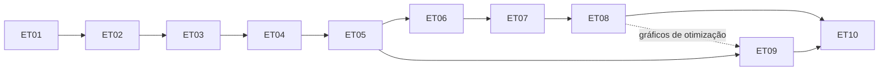

# Plano da primeira versão (v0.1)

**Estado:** vigente · **Atualizado em:** 2026-11-01

Plano de execução por etapas da primeira versão do EnziTAG Optima. Recorta o [roteiro do produto](roteiro-produto.md) a partir das [decisões aprovadas](../produto/decisoes-aprovadas.md) e do [catálogo funcional](../produto/catalogo-funcional.md). A versão-alvo de cada método está na [matriz de cobertura](../produto/matriz-cobertura.md). A numeração da versão segue a [DT-0002](../decisoes-tecnicas/dt-0002-versionamento-primeira-versao.md).

**Situação:** nenhuma etapa concluída. Etapas ativas: [ET01 — Fundação técnica](ativos/et01-fundacao-tecnica.md) (só evidência Windows pendente) e [ET02 — Primeiro percurso](ativos/et02-primeiro-percurso.md).

## 1. Definição da primeira versão

| Item | Definição |
|---|---|
| Identificação | `v0.1.0`, canal **experimental** |
| Público | Colegas e alunos do laboratório, inclusive sem experiência em estatística |
| Plataformas | Windows 11 de 64 bits (Tauri) e versões atuais de Chrome, Edge e Firefox (WebAssembly) |
| Idiomas e temas | Português (`pt-BR`) e inglês (`en`); Soft Light (padrão), Modern Dark e Professional |
| Uso | Local, sem login; projetos `.enzitag` abertos e salvos no computador |
| Objetivo | Cobrir os dois percursos típicos do laboratório com cálculos validados e rastreáveis |

Os dois percursos que a v0.1 precisa entregar completos, nas duas plataformas:

1. **Comparar tratamentos:** quatro condições de reação enzimática com réplicas experimentais independentes → ANOVA de um fator → Tukey–Kramer → letras no gráfico → exportação → salvar e reabrir.
2. **Planejar e otimizar:** triagem Plackett–Burman → superfície de resposta (DCCR/CCRD) → otimização de uma ou várias respostas → proposta de ensaios de confirmação.

Esses percursos correspondem ao primeiro exemplo integrado aprovado (§13 das decisões) e aos casos típicos da concepção (PB e otimização de cultivos ou reações enzimáticas). Também cobrem a lista de planejamentos do Protimiza visível nas capturas (CCRD, FCD, CCD, FFD, PB e Custom Design).

## 2. Escopo incluído

| Área | Incluído na v0.1 | Etapa |
|---|---|---|
| Base técnica | Workspace Rust, WASM, React/TypeScript, Tauri, contratos versionados, CI | ET01 |
| Interface | Tela inicial com três entradas, fluxo guiado de cinco etapas, opções avançadas por etapa | ET02 |
| Idiomas e temas | PT/EN completos, três temas, preferências por dispositivo, acessibilidade por teclado | ET02 e todas |
| Dados | Digitação, colagem do Excel, CSV, XLSX, matrizes externas, papéis das colunas, réplicas × medições | ET02–ET03 |
| Projetos | `.enzitag` com vários experimentos, revisões, análises vinculadas, migrações | ET03 |
| Salvamento | Abrir, salvar, salvar cópia; recuperação após 2 s de pausa; checkpoints; substituição segura no Windows | ET03 |
| Fundamentos | Somas estáveis, álgebra matricial (QR), funções especiais, Normal/t/F/qui-quadrado | ET04 |
| Modelos | Regressão linear, termos categóricos, interações, quadráticos, resíduos, influência, estimabilidade | ET04 |
| Descritiva | Contagem, ausentes, média, variância, desvio-padrão, resumos por grupo | ET02 |
| Comparação | DIC, ANOVA de um fator, amplitude studentizada, Tukey/Tukey–Kramer, letras, diagnóstico de resíduos | ET05 |
| Triagem | Fatorial completo 2^k, fracionário (geradores, resolução, confundimento), Plackett–Burman, pontos centrais, aleatorização com semente | ET06 |
| Superfícies | DCCR/CCRD, face centrada (FCD), opção rotulada CCD após conferência, Box–Behnken, planejamento personalizado/importado, falta de ajuste e erro puro | ET07 |
| Otimização | Maximizar, minimizar, alvo, faixa; restrições × preferências; desejabilidade com pesos; vários candidatos; confirmação | ET08 |
| Gráficos | Médias com incerteza e letras, resíduos, efeitos, interações, Pareto, observado × predito, superfície 3D, contorno, desejabilidade | ET05–ET08 |
| Interpretação | Explicações curtas PT/EN com conclusão, evidência e próximo passo | ET02 e todas |
| Exportação | Figuras **SVG e PNG**; tabelas **CSV e XLSX**; relatório **HTML**; proveniência; personalização essencial | ET05, ET09 |
| Distribuição | Build web estática, instalador Windows, notas de versão, atualizador assinado no canal experimental | ET10 |

## 3. Fora da v0.1

Nada abaixo sai do escopo final aprovado; apenas não integra a primeira versão.

| Item | Fase do roteiro | Destino indicativo |
|---|---|---|
| DBC e blocos em planejamentos, ANOVA multifatorial geral, médias marginais, contrastes planejados | F08 | v0.2 |
| Welch/Games–Howell, Dunnett, Bonferroni/Holm, Kruskal–Wallis/Dunn, comparações pareadas | F08 | v0.2 |
| PDF de figuras e relatórios; personalização gráfica completa | F10 | v0.2 |
| Google Drive, pasta visível, abrir compartilhado e criar cópia | F11 | v0.3 |
| Níveis mistos, misturas, ótimos/restritos, modelos mistos, medidas repetidas, não lineares (Monod), potência | F09a–F09g | v0.4 em diante |
| Canal estável e cobertura completa do catálogo | F12–F13 completos | v1.0.0 |
| Comentários, DOCX, Windows 10, Safari, domínio próprio, colaboração simultânea | F14 | após v1.0.0 |

Os destinos são indicativos e serão confirmados ao planejar cada versão. A [matriz de cobertura](../produto/matriz-cobertura.md) é a fonte por método.

## 4. Etapas

| Etapa | Nome | Fases | Depende de | Entrega principal | Marco |
|---|---|---|---|---|---|
| [ET01](ativos/et01-fundacao-tecnica.md) | Fundação técnica e contratos iniciais | F00 | — | Ambiente reproduzível, pacotes reais, contrato tipado nas duas plataformas, CI | — |
| [ET02](ativos/et02-primeiro-percurso.md) | Primeiro percurso ponta a ponta | F01 | ET01 | Interface básica, temas, idiomas, estatística descritiva nas duas plataformas | — |
| [ET03](ativos/et03-projeto-local-importacao.md) | Projeto local, importação e recuperação | F02 | ET02 | `.enzitag`, revisões, importação, salvamento e recuperação | **M1** |
| [ET04](ativos/et04-fundamentos-numericos-modelos.md) | Fundamentos numéricos e modelos lineares | F03 | ET03 | Álgebra, distribuições, regressão e diagnósticos validados | — |
| [ET05](ativos/et05-anova-tukey-letras.md) | ANOVA, Tukey e letras | F04 | ET04 | Percurso de comparação completo e exportação inicial | **M2** |
| [ET06](concluidos/et06-fatoriais-plackett-burman.md) | Fatoriais, fracionários e Plackett–Burman | F05 | ET04, ET05 | Geração e análise de planejamentos de triagem | — |
| [ET07](concluidos/et07-superficies-resposta.md) | Superfícies de resposta e planejamento personalizado | F06 | ET06 | Compostos centrais, Box–Behnken, modelo de 2ª ordem, superfícies | — |
| [ET08](concluidos/et08-otimizacao.md) | Otimização de uma ou várias respostas | F07 | ET07 | Desejabilidade, candidatos e confirmação | **M3** |
| [ET09](ativos/et09-graficos-exportacao.md) | Gráficos e exportação essenciais | F10 (recorte) | ET05 | Personalização essencial e formatos da v0.1 em todos os gráficos | — |
| [ET10](ativos/et10-integracao-publicacao.md) | Integração, verificação e publicação | F12, F13 (recortes) | ET01–ET09 | Versão `v0.1.0` verificada e publicada | **v0.1.0** |

A sequência ET01–ET08 é obrigatória por dependência técnica. ET09 pode começar depois da ET05 e avançar em paralelo, mas só termina depois de cobrir os gráficos de ET06–ET08. Regra de trabalho: uma etapa ativa por vez; o paralelismo de ET09 é registrado no [índice](README.md).

Ao final da ET05 é possível gerar uma pré-versão interna para testes com colegas, sem publicação e sem alterar o escopo da v0.1.

## 5. Marcos

| Marco | Concluído quando | Verificação |
|---|---|---|
| M1 — Base utilizável | ET01–ET03 concluídas | Aplicativo nas duas plataformas, PT/EN, três temas, projeto local recuperável e reaberto entre plataformas |
| M2 — Comparação completa | ET04–ET05 concluídas | Quatro condições → ANOVA → Tukey → letras → exportação → reabertura, com referência independente |
| M3 — DoE e otimização | ET06–ET08 concluídas | PB → DCCR → otimização → confirmação, com matrizes e modelos validados |
| v0.1.0 | ET09–ET10 concluídas | Critérios de lançamento da seção 6 |

## 6. Critérios de lançamento da v0.1.0

1. ET01–ET10 concluídas, com evidências registradas nos respectivos planos.
2. Todo item marcado `v0.1` na [matriz de cobertura](../produto/matriz-cobertura.md) está **validado**, com link para a evidência, ou foi reclassificado por mudança de escopo registrada (seção 8).
3. Os dois percursos da seção 1 funcionam no Windows 11 de 64 bits e nas versões atuais de Chrome, Edge e Firefox, com salvar/reabrir/exportar.
4. Interface completa em PT e EN; três temas; navegação por teclado, foco visível e contraste verificados.
5. Arquivos `.enzitag` reabrem entre plataformas; recuperação, falha de escrita e arquivo inválido não perdem dados nos cenários testados.
6. Formatos de exportação da v0.1 abertos e inspecionados visualmente.
7. Notas de versão listam métodos e variantes disponíveis, situação de validação por método e limitações conhecidas.
8. Decisão de hospedagem e visibilidade ([PD-15](../produto/decisoes-pendentes.md)) tomada pelo usuário; artefatos publicados abertos e testados; atualização a partir de uma versão anterior verificada.

## 7. Pendências que afetam a v0.1

As pendências estão no [registro de decisões pendentes](../produto/decisoes-pendentes.md). Cada uma é resolvida por uma decisão técnica (DT) na etapa indicada:

| Pendência | Etapa da v0.1 |
|---|---|
| PD-01 Versões e dependências | ET01 e etapas que adotarem dependências |
| PD-02 Contêiner `.enzitag`, esquema e migrações | ET03 |
| PD-03 Retenção do histórico e limites de recuperação | ET03 |
| PD-04 Variantes, estimadores, algoritmos e tolerâncias | ET04–ET08 |
| PD-05 Inventário Protimiza e rótulo CCD | ET06–ET07 |
| PD-06 Grade de dados, gráficos e renderização 3D | ET02, ET05, ET07, ET09 |
| PD-07 Estratégia de busca da otimização | ET08 |
| PD-08 Dados reais autorizados | Todas |
| PD-11 Assinatura de código do instalador | ET10 |
| PD-12 Matriz de compatibilidade de navegadores | ET10 |
| PD-15 Hospedagem web e visibilidade do repositório | ET10 (decisão do usuário) |

## 8. Controle de mudanças de escopo

- Incluir ou remover item da v0.1: atualizar este plano (seções 2–3), a [matriz de cobertura](../produto/matriz-cobertura.md) e o plano da etapa afetada, registrando motivo e data na seção 10.
- Mudança de requisito de produto exige decisão do usuário e atualização das [decisões aprovadas](../produto/decisoes-aprovadas.md); este plano não altera requisitos.
- Escolha técnica nova é registrada como DT em [decisões técnicas](../decisoes-tecnicas/README.md).
- Um método que não atingir validação pode sair da v0.1 apenas como mudança registrada; não pode ser publicado como validado.

## 9. Riscos principais

| Risco | Efeito | Mitigação |
|---|---|---|
| Precisão de distribuições (caudas, amplitude studentizada) | p-valores e Tukey incorretos | Validar cedo contra R, SciPy e mpmath; tolerâncias por grandeza (ET04–ET05) |
| Diferenças nativo × WASM em funções matemáticas | Resultados divergentes entre plataformas | Testes de paridade com tolerância; avaliar implementação matemática única nos dois alvos (DT em ET04) |
| Crescimento de escopo | Atraso da v0.1 | Seção 8, matriz de cobertura e uma etapa ativa por vez |
| Custo de CI Windows em repositório privado | Cota de minutos consumida rapidamente | Build Windows em `main`, em etiquetas e manual; demais verificações em Linux (ET01) |
| Publicação web com repositório privado | GitHub Pages indisponível no plano gratuito | PD-15 decidida antes da ET10 |
| Licenças e peso de bibliotecas JS (grade, planilha, 3D) | Incompatibilidade com MIT ou pacote web grande | Critérios de licença e tamanho nas DTs (ET02, ET03, ET05, ET07) |
| Ferramentas WASM em transição de manutenção | Build web quebrado | Verificar situação das ferramentas em ET01 e fixar versões |
| Instalador sem assinatura de código | Alertas do Windows ao instalar | PD-11; documentar instalação nas notas da versão |
| Inventário Protimiza incompleto | Cobertura declarada incorreta | ET06 conclui inventário; notas de versão dizem o que foi conferido |

## 10. Registro de alterações deste plano

| Data | Alteração |
|---|---|
| 2026-11-01 | Plano criado a partir das decisões aprovadas e do roteiro F00–F14; ET01 ativada. |
