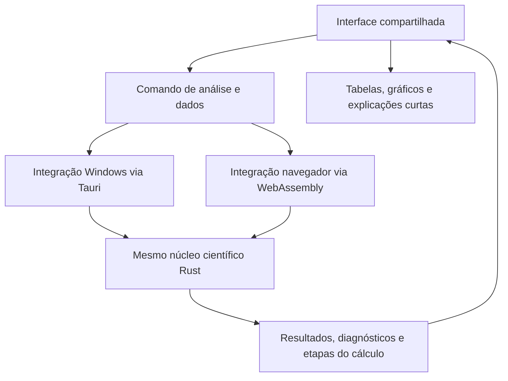

# EnziTAG Optima — arquitetura e aprendizagem

Data: 1º de novembro de 2026.

Este documento organiza a arquitetura aceita e propõe uma sequência de desenvolvimento e estudo. O escopo funcional está em [CONCEPCAO_APP.md](CONCEPCAO_APP.md). A estrutura local está preparada para o GitHub; ainda não há repositório remoto criado, aplicativo executável ou publicação.

## Decisão de arquitetura

- **Rust:** procedimentos estatísticos, geração de planejamentos, modelos, comparações e otimização.
- **TypeScript/React:** interface compartilhada, tabelas, controles e apresentação gráfica.
- **Windows:** aplicativo com Tauri e motor Rust compilado para o sistema.
- **Navegador:** interface web com o mesmo motor Rust compilado para WebAssembly.
- **Distribuição proposta:** repositório público, versão web no GitHub Pages e instaladores no GitHub Releases. Licença e configuração de hospedagem ainda serão definidas.
- **Uso local obrigatório:** projetos podem ser criados, abertos, analisados e salvos sem login.
- **Integração opcional em avaliação:** Google Drive para arquivos de cada usuário, com autorização solicitada apenas ao utilizar essa opção.

As áreas reservadas à implementação estão descritas em [app/README.md](../app/README.md): `app/crates/optima-core`, `app/crates/optima-wasm`, `app/web` e `app/desktop`. Essas pastas contêm apenas documentação de responsabilidades nesta etapa.

O núcleo de cálculo recebe dados e configurações e devolve resultados estruturados. Ele não depende de uma tela, de um arquivo Excel, de uma janela Windows ou de uma conta online. Camadas de integração cuidam dessas diferenças.

As duas integrações são alternativas conforme o ambiente de execução. A validação deve verificar o resultado do motor e a passagem dos dados pelas duas integrações.

## Como estudar cada módulo

Cada módulo deve vir acompanhado de:

1. Pergunta que ele responde e condições em que pode ser utilizado.
2. Definição das entradas, unidades, saídas e situações em que o resultado não pode ser calculado.
3. Fórmulas e algoritmo, com um exemplo pequeno que possa ser acompanhado manualmente.
4. Implementação Rust explicada, incluindo as decisões numéricas.
5. Valores intermediários identificados para conferir o caminho até o resultado.
6. Dependências: o que recebe de outros módulos e o que entrega ao restante do app.
7. Comparação com resultados independentes, registrando dados, versões, opções e tolerâncias.
8. Ligação com a interface e demonstração no Windows e no navegador, quando aplicável.

A explicação detalhada é material de aprendizagem e documentação do projeto. A interface para alunos do laboratório mantém as explicações curtas junto aos resultados, conforme solicitado.

## Política para bibliotecas

Os procedimentos estatísticos serão desenvolvidos em módulos próprios, com escolhas matemáticas explícitas. Bibliotecas de interface, desenho de gráficos, leitura de arquivos e comunicação podem apoiar o produto.

Para qualquer biblioteca numérica considerada, documentar qual parte do cálculo ela executa, o algoritmo utilizado e as limitações relevantes. A escolha entre implementação própria e dependência auxiliar será feita por rotina; a preferência do usuário é entender o funcionamento, mesmo quando isso ampliar o trabalho. Uma versão didática e uma versão usada em produção precisam ter sua relação e suas diferenças documentadas quando não forem a mesma implementação.

Python e softwares especializados serão referências de validação. O aplicativo distribuído deve executar o motor científico em Rust.

## Mapa dos módulos

Esta tabela descreve famílias de responsabilidades. Não pressupõe que uma única rotina estatística resolva todas as estruturas experimentais.

| Módulo | Responsabilidade | Conexões principais |
|---|---|---|
| Dados experimentais | Representar fatores, níveis, respostas, tratamentos, corridas, unidades experimentais, blocos e tempos | Entrada comum de planejamentos e análises |
| Validação de entrada | Verificar tipos, valores, dimensões e informações exigidas pelo método | Antecede os cálculos e devolve mensagens compreensíveis |
| Estatística descritiva | Contagens, médias, dispersão e resumos | Alimenta tabelas, exemplos e verificações preliminares |
| Fundamentos numéricos | Operações matriciais e rotinas numéricas necessárias aos métodos | Apoia modelos, distribuições e otimização |
| Distribuições e quantis | Probabilidades, valores críticos e funções auxiliares | Apoia testes, intervalos e comparações |
| Modelos | Regressões e estruturas apropriadas para grupos, fatores, blocos, pares e repetições no tempo | Produz estimativas, predições e informação sobre incerteza |
| Inferência e diagnósticos | ANOVA, intervalos, resíduos e avaliações compatíveis com o modelo | Apoia a interpretação e verifica o que é estimável |
| Comparações | Tukey e outros procedimentos compatíveis com a pergunta e o modelo | Recebe estimativas e estrutura de incerteza apropriadas |
| Letras de comparação | Converter resultados de comparações pareadas em uma representação por letras | Usa a família de comparações e o nível de significância selecionados |
| Planejamentos | Gerar matrizes, codificações, réplicas, blocos e ordem de execução | Produz dados estruturados para execução e análise |
| Predição e gráficos científicos | Preparar valores preditos, superfícies, contornos, efeitos, interações e resíduos | Usa resultados dos modelos; a interface desenha os gráficos |
| Otimização | Buscar condições a partir das predições, objetivos e restrições | Usa modelos de resposta e rotinas de busca |
| Interpretação | Preparar explicações curtas coerentes com resultados e diagnósticos | Mantém vínculo com o modelo e as opções utilizadas |
| Projetos e arquivos | Salvar, reabrir e transferir dados, configurações e resultados | Integra desktop e navegador sem alterar os procedimentos científicos |
| Conector Google Drive, proposto | Autorizar acesso e abrir/salvar arquivos na conta do usuário | Reutiliza o formato de projeto; trabalha fora do motor científico |

Novos métodos podem reaproveitar essa estrutura. Quando a pergunta exigir outra estrutura de dependência ou outro modelo, a extensão deverá incluir essa diferença explicitamente.

O armazenamento segue a mesma separação: o conteúdo do projeto é comum aos destinos local e Drive. Autorizações, estado da conexão e conflitos de versões pertencem à camada de armazenamento. O motor de cálculo continua utilizável sem login. A proposta e as fontes da integração estão em [CONCEPCAO_APP.md](CONCEPCAO_APP.md).

As letras serão geradas a partir das comparações calculadas, preservando sua ligação com os grupos exibidos. A legenda tradicional explicará que compartilhar uma letra indica ausência de diferença detectada pelo procedimento; não afirma equivalência. Referência: [documentação de letras de comparação do emmeans](https://rvlenth.github.io/emmeans/reference/CLD.emmGrid.html).

## Sequência proposta de aprendizagem e desenvolvimento

A sequência representa dependências de aprendizagem, mantendo a visão de um aplicativo completo.

1. **Um caminho completo e pequeno:** cadastrar dados, calcular média e variância em Rust e exibir o resultado no Windows e no navegador. Conhecer a passagem dos dados de ponta a ponta desde o começo.
2. **Fundamentos de cálculo:** ampliar estatística descritiva, funções numéricas e distribuições, explicando precisão e tratamento de entradas.
3. **Comparação inicial:** desenvolver o modelo para grupos independentes, ANOVA, Tukey, geração das letras e gráfico correspondente.
4. **Modelos e outras estruturas:** regressão, fatores e interações, controle, blocos, pares e acompanhamento no tempo, com procedimentos e diagnósticos apropriados a cada caso.
5. **Planejamento experimental:** matrizes fatoriais, fracionários, PB e planejamentos de superfície de resposta; estudar codificação e condições de estimação junto aos modelos utilizados.
6. **Superfícies e otimização:** predições, contornos, superfícies 3D e objetivos para uma ou várias respostas.
7. **Cobertura e distribuição:** expandir famílias de métodos, interoperabilidade, documentação e versões publicáveis, preservando a validação de cada módulo.

## Validação durante o desenvolvimento

A comparação externa acompanha a conclusão de cada módulo. Casos manuais pequenos ajudam a verificar as etapas; Python e softwares especializados fornecem referências independentes para os métodos completos.

Cada comparação deve registrar configurações equivalentes: tipo de modelo, termos, codificação, estimador, graus de liberdade, família de comparações, nível de significância e tratamento de dados ausentes, conforme o procedimento. Diferenças precisam ser investigadas antes de o módulo ser considerado validado para os casos cobertos.

A validação inclui casos regulares e situações relevantes ao método, como tamanhos desiguais, valores ausentes, variância residual nula ou informação insuficiente. Registrar o comportamento esperado em vez de produzir um número sem significado.

Os resultados calculados devem preservar a precisão interna; arredondamento pertence à apresentação. Conferir o funcionamento nos dois destinos com tolerâncias justificadas, sem presumir identidade de todos os dígitos.

Um conjunto de casos aprovados será preservado para detectar alterações involuntárias quando outros módulos forem acrescentados. A validação de um método ou de um caminho inicial não significa que todo o aplicativo esteja validado.
