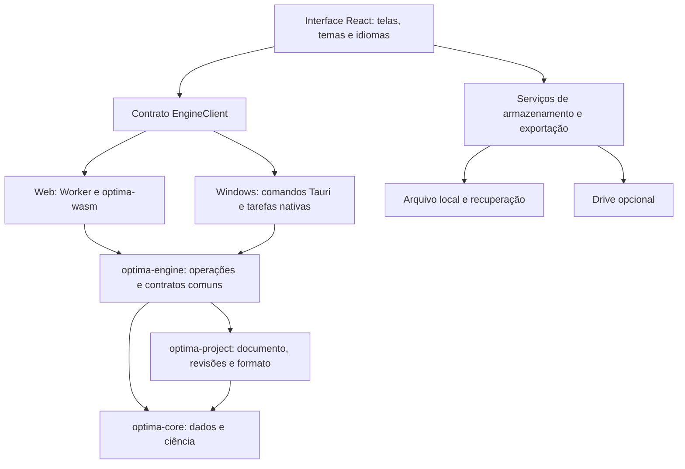

# Plano de implementação — EnziTAG Optima

Data: 1º de novembro de 2026.

**Objetivo:** construir o aplicativo completo para Windows e navegador, com procedimentos científicos em Rust, interface compartilhada, uso local sem login, integração opcional com Google Drive e módulos identificáveis para manutenção.

**Estado:** planejamento detalhado. Não há aplicativo executável, motor científico implementado, validação numérica concluída ou publicação. Todas as fases abaixo começam como pendentes; a documentação existente é insumo, não evidência de conclusão das fases de código.

## 1. Documentos e precedência

- [Decisões aprovadas](DECISOES_APROVADAS.md): requisitos do produto, incluindo os 14 pontos aprovados e a correção sobre organização modular.
- [Catálogo funcional](CATALOGO_FUNCIONAL.md): abrangência científica a entregar.
- [Mapa de módulos e arquivos](../docs/MAPA_MODULOS.md): localização de cada responsabilidade, entradas, saídas e dependências.
- [Temas](../docs/temas/README.md): referências visuais originais e adaptação EnziTAG.
- [Detalhes ainda pendentes](DECISOES_PENDENTES.md): escolhas específicas que não impedem a preparação dos demais módulos.

O objetivo de aprendizagem é poder localizar, compreender e manter cada parte do aplicativo. Não organizar o cronograma como aulas de Rust. Documentação matemática e exemplos acompanham os módulos científicos conforme necessário.

Decisões de produto estão aprovadas. A decomposição técnica, o contêiner interno do projeto e os algoritmos abaixo são propostas de implementação a verificar na fase correspondente; não representam métodos já validados nem escolhas adicionais atribuídas ao usuário.

## 2. Arquitetura e fronteiras

Regras de implementação:

1. Um único cálculo científico em Rust atende Windows e navegador; não reproduzir fórmulas no frontend ou nos adaptadores.
2. O core recebe dados e configurações; não acessa rede, sistema de arquivos, idioma ou tema.
3. Documento do projeto e cálculo são separados: alterar o destino de salvamento não modifica resultados.
4. A interface solicita operações e apresenta respostas estruturadas; regras científicas de elegibilidade são verificadas no motor.
5. Cada módulo tem arquivos responsáveis e API explícita conforme o mapa; não criar arquivos monolíticos por tela ou aplicativo.
6. Dependências são direcionais. Core não importa engine/project; engine não importa os adaptadores; funcionalidades da interface acessam o motor pelo contrato comum.
7. Requisitos de português/inglês, três temas e execução nas duas plataformas são transversais desde a primeira interface executável.

## 3. Organização dos contratos e dos dados

### 3.1 Dados experimentais

Representar fatores quantitativos/categóricos, respostas, unidades, níveis, valores codificados/reais, tratamentos, corridas, ordem planejada/executada, unidades experimentais, blocos, réplicas experimentais, repetições de medição e tempos. Permitir várias respostas e dados faltantes explícitos.

Não usar o número da linha como identidade permanente. Relacionar observações e unidades experimentais por IDs. As transformações de dados registram origem, regra e revisão; dados originais permanecem disponíveis. Ausências, filtros ou exclusões nunca mudam silenciosamente a amostra analisada.

### 3.2 Métodos e resultados

Cada método declara ID, versão, entradas obrigatórias, estruturas compatíveis, opções, saídas e status de implementação/validação. A interface usa esse registro para apresentar métodos e explicar indisponibilidades; não oferecer cálculo fictício para método ainda não entregue.

Contratos incluem erros por código, avisos com evidência, estimabilidade, convergência e proveniência. Cálculos indefinidos geram estado explícito, não `NaN`, infinito ou zero usado como substituto. Resultados dependem de uma revisão fixa; edição posterior marca a análise anterior como baseada em dados anteriores.

O protocolo Rust/TypeScript será versionado e terá tipos gerados. Verificar serialização nos dois transportes, campos opcionais, IDs, enums, números e erros. Não confiar apenas em tipos TypeScript para validar dados importados.

### 3.3 Arquivo `.enzitag`

Proposta técnica inicial: contêiner ZIP com `manifest.json`, documento JSON versionado, dados/fontes anexados quando necessário e recursos de apresentação. A escolha final do contêiner será registrada em uma decisão técnica na fase F02 após avaliar tamanho, leitura no navegador e migrações.

Documento contém projeto, vários experimentos, revisões dos dados, planejamentos, análises, modelos alternativos, gráficos, observações e histórico. Resultados preservam versão do motor, configuração, semente e referência aos dados. Credenciais Google não fazem parte do arquivo.

Migrações operam sobre cópia e preservam o original. Arquivos de versão futura não são regravados de forma destrutiva. Validar conteúdo, tamanho descompactado, caminhos internos e integridade; falhas não apagam o projeto aberto.

## 4. Fases, entregas e critérios de conclusão

As fases são dependências de trabalho, não promessas de datas. Cada uma terá uma lista executável de tarefas em seu início. Uma entrega termina quando os critérios abaixo possuem evidência; uma tela pronta não conclui seu método científico.

### F00 — Preparação e contratos iniciais

**Depende de:** documentos aprovados. **Módulos:** C01–C02, C19, E01, U12, U17–U18 (estruturas iniciais).

- Inventariar ferramentas locais e configurar Rust, alvo WASM, Node e pré-requisitos Windows/Tauri.
- Criar workspace Cargo em `app/Cargo.toml`, pacotes core/project/engine/wasm, frontend React/TypeScript e invólucro Tauri.
- Fixar versões verificadas em `rust-toolchain.toml`, manifests e lockfiles; registrar justificativas das dependências, inclusive licenças e compatibilidade WASM.
- Criar comandos documentados para desenvolvimento, verificação, build web e build Windows. Comandos só entram no README depois de existirem e serem executados.
- Definir contratos mínimos de dados, solicitação, resultado, erro e capacidades; criar geração/verificação dos tipos TypeScript.
- Preparar verificação automatizada de formatação, tipos, compilação e testes que existirem; futuras rotinas científicas ampliam a suíte.

**Entregas:** ambiente reproduzível, estrutura real de código, contratos iniciais e registro das dependências.

**Concluída quando:** um clone limpo compila um pacote Rust, frontend, WASM e aplicativo Windows; o transporte de uma resposta tipada funciona nos dois ambientes. Ainda não é entrega científica.

### F01 — Primeiro percurso completo e interface básica

**Depende de:** F00. **Módulos:** C01–C03/C05 iniciais, E01–E04, U01–U04, U08, U12, U17–U19.

- Implementar tela inicial, três entradas, fluxo de cinco etapas, cadastro básico e tabela de observações.
- Implementar média, contagem e variância com política explícita para dados ausentes e amostra insuficiente.
- Ligar entrada → motor → resultado nos dois ambientes; selecionar idioma e tema preservando dados.
- Aplicar Soft Light padrão, Modern Dark e Professional a componentes comuns; logo e cores conforme referências preservadas.
- Separar formatação numérica de valores; fornecer mensagens PT/EN de entrada inválida e falha de cálculo.
- Iniciar Worker no navegador e execução nativa fora da thread da interface; tarefas têm ID para descartar respostas antigas.

**Entregas:** primeiro caminho executável, pequeno e completo, com os arquivos de cada camada documentados.

**Concluída quando:** mesmos dados produzem resultados equivalentes nos dois ambientes, com referência independente; navegação por teclado, troca de temas/idiomas e tratamento de entrada inválida verificados.

### F02 — Projetos locais, revisão, importação e recuperação

**Depende de:** F01. **Módulos:** P01–P03, U03–U05, U11, U13.

- Implementar vários experimentos por projeto, IDs estáveis, revisão dos dados, observações e resultados vinculados à revisão.
- Especificar e implementar `.enzitag`, incluir exemplos de esquema, migração e arquivo de referência em `docs/formato-projeto.md`.
- Implementar abrir, salvar, salvar cópia e reabrir nas duas plataformas; reutilizar o mesmo codificador/decodificador em Rust.
- Implementar digitação/colagem, CSV e XLSX com prévia, papéis de colunas, decimal, separador, unidades e ausências. Fórmulas de planilhas não serão executadas; apresentar política explícita para valores armazenados/ausentes.
- Implementar importação de matrizes externas por mapeamento de colunas; não presumir desenho a partir do nome do arquivo.
- Criar recuperação após dois segundos de inatividade e checkpoints de revisão por operação, sem uma cópia completa por tecla.
- Windows: gravar temporário, verificar e substituir com cópia anterior. Navegador: recuperação local e download explícito, sem prometer atualização automática de arquivo sem permissão.
- Representar estados de salvamento e falhas de armazenamento; manter sessão editável após falha.

**Concluída quando:** projeto criado no Windows reabre no navegador e vice-versa sem perda de dados/configuração; interrupção de escrita, arquivo inválido, sessão recuperada e migração têm casos verificáveis. As importações testam acentos, vírgula decimal, faltantes e réplicas/medições distintas.

### F03 — Fundamentos numéricos e modelos lineares

**Depende de:** F01–F02. **Módulos:** C03–C08, C19.

- Especificar somas estáveis, álgebra matricial, decomposições, rank, condicionamento, funções especiais e probabilidades necessárias.
- Priorizar ajuste por QR com tratamento de rank; avaliar SVD para diagnóstico/fallback. Não basear a regressão em inversão explícita indiscriminada de matrizes.
- Implementar Normal, t e F, funções de cauda e quantis com tolerâncias documentadas; acrescentar demais distribuições quando seus consumidores forem entregues.
- Implementar construção da matriz de modelo, codificação categórica, intercepto, termos, interações, coeficientes, covariância, predições e resíduos.
- Registrar estimabilidade, graus de liberdade e casos insuficientes; definir comportamento para variância nula, colinearidade e magnitudes extremas.
- Implementar tabelas/resultados comuns e diagnósticos básicos; especificar diferenças entre efeitos e coeficientes.

**Concluída quando:** rotinas utilizadas passam casos independentes de precisão normal e situações numericamente difíceis, com métricas/tolerâncias explícitas. Rank deficiente e dados insuficientes produzem diagnóstico compreensível.

### F04 — Comparação de tratamentos, ANOVA e Tukey com letras

**Depende de:** F03. **Módulos:** C04/studentized_range, C06–C09, C16/C18, U07–U09, U16 inicial.

- Entregar DIC e ANOVA de um fator com especificação de independência, estimativas, graus de liberdade, F, p, intervalos e diagnósticos.
- Implementar distribuição da amplitude studentizada com validação própria antes de disponibilizar Tukey/Tukey–Kramer.
- Definir família das comparações, alpha e tratamento de tamanhos desiguais; calcular pares, intervalos e p ajustados.
- Gerar letras a partir das comparações. Não tratar pares não estimáveis/não testados como ausência de diferença. Verificar pares significativos, sobreposições, ordem estável e rótulos além de 26 grupos.
- Entregar gráfico de médias com incerteza identificada, letras e legenda curta; tabela de pares acessível a partir do gráfico.
- Entregar o exemplo sintético das quatro condições de reação enzimática com réplicas experimentais; valores sintéticos explicitamente identificados.
- Iniciar exportação de tabela CSV e figura PNG/SVG com proveniência; formatos restantes continuam em F10.

**Concluída quando:** exemplo percorre importação → ANOVA → Tukey → letras → exportação → reabertura nas duas plataformas, com resultados independentes compatíveis. Letras são verificadas semanticamente, sem exigir a mesma escolha de caracteres de outro software.

### F05 — Fatoriais, fracionários e Plackett–Burman

**Depende de:** F03; reutiliza apresentação de F04. **Módulos:** C11, C06–C08, C16/C18, U06–U09.

- Gerar fatoriais completos de dois níveis, DIC, réplicas, pontos centrais, ordem padrão/aleatória e codificação real/codificada; registrar semente e ordem efetivamente usada.
- Implementar fracionários com geradores, relação definidora, resolução e estrutura de confundimento; separar limitações de estimabilidade de opções do usuário.
- Implementar PB por construções/matrizes documentadas, cobrindo tamanhos suportados explicitamente; não prometer qualquer número arbitrário de ensaios.
- Permitir fatores e respostas livres, níveis e unidades; apresentar custo de ensaios antes de gerar matrizes grandes.
- Entregar regressão dos termos estimáveis, efeitos, interações quando suportadas, Pareto, observado versus predito e diagnósticos.
- Documentar comportamento de desenhos saturados, ausência de erro residual, interação confundida e pontos centrais.
- Completar inventário do Protimiza usando fontes disponíveis; esclarecer a opção rotulada CCD antes de associar-lhe uma matriz ou nome científico.

**Concluída quando:** matrizes e propriedades (contagem, níveis, ortogonalidade quando esperada, geradores, codificação e aleatorização reprodutível) são verificadas independentemente; o fluxo PB funciona sem apresentar testes não estimáveis como válidos.

### F06 — Superfícies de resposta e planejamento personalizado

**Depende de:** F03/F05. **Módulos:** C12, C06–C08, C16, U06–U09.

- Implementar composto central rotacional, face centrada e parametrizações justificadas, com pontos axiais, centros e réplicas.
- Implementar Box–Behnken nos números de fatores suportados; documentar elegibilidade e contagem.
- Implementar matriz personalizada/importada e escolha de modelo, verificando rank, estimabilidade e domínio.
- Ajustar termos lineares, interações e quadráticos; editar termos com indicação de hierarquia e histórico, sem eliminação automática silenciosa por valor-p.
- Calcular ANOVA da regressão, erro puro e falta de ajuste quando identificáveis; explicitar quando não há informação suficiente.
- Preparar malhas 3D/contornos em Rust; interface permite escolher dois eixos e fixar os demais fatores, exibindo essas condições.

**Concluída quando:** matrizes e ajustes correspondem às especificações, superfícies reproduzem predições do modelo e regiões inválidas são identificadas. A equação exibida usa a codificação indicada e coincide com o preditor.

### F07 — Otimização de uma ou várias respostas

**Depende de:** F06. **Módulos:** C17, C06/prediction, U10.

- Implementar maximização, minimização, alvo e faixa, distinguindo limites obrigatórios, prioridades e pesos.
- Implementar desejabilidade individual/conjunta documentada, incluindo respostas fora das faixas e desejabilidade zero.
- Escolher algoritmo de busca com critérios de parada, múltiplos inícios quando necessário, semente e relatório de convergência. Não afirmar ótimo global sem justificativa.
- Produzir candidatos viáveis, ordenação, condições reais/codificadas e previsão/intervalo quando disponível.
- Restringir domínio ao especificado por padrão; permitir extensão somente com escolha explícita e identificação da extrapolação.
- Registrar proposta de ensaios de confirmação como novo experimento vinculado ao anterior.

**Concluída quando:** casos com solução conhecida, fronteira, conflito de objetivos e região inviável têm comportamento correto; nenhum candidato listado como viável viola restrição além da tolerância registrada.

### F08 — Blocos, comparações ampliadas e não paramétricos

**Depende de:** F03/F04. **Módulos:** C04 adicionais, C06–C11, U03/U07–U09.

- Entregar DBC e modelos multifatoriais, contrastes e médias marginais estimadas; explicitar somas de quadrados, codificação e hipóteses em dados desbalanceados.
- Implementar Welch/Games–Howell, Dunnett, Bonferroni/Holm e contrastes planejados com suas referências e famílias de hipóteses.
- Implementar Kruskal–Wallis/Dunn, tratamento de empates e ajustes de multiplicidade.
- Implementar comparações pareadas compatíveis e identificação de unidade experimental; não reutilizar independência de grupos em dados dependentes.
- Acrescentar recomendações contextuais e diagnósticos, sem trocar automaticamente de método apenas por um teste de pressuposto.

**Concluída quando:** casos balanceados/desbalanceados, controle, blocos, empates e dependência são cobertos por referências apropriadas. Estimativas, graus de liberdade e família de comparações coincidem com a especificação, não somente com um valor-p isolado.

### F09 — Famílias avançadas do catálogo

**Depende de:** F03/F06/F08; potência depende do método correspondente. **Módulos:** C13–C15 e extensões de C04/C06/C17.

Esta fase possui entregas independentes; não tratar como uma única tarefa:

| Entrega | Especificação e trabalho | Aceite mínimo |
|---|---|---|
| F09a — Níveis mistos | Fatores com diferentes níveis, contrastes e planejamento compatível | Matrizes e estimabilidade verificadas |
| F09b — Misturas | Restrição de soma, componentes, modelos e domínio próprio | Respeito à composição e referência independente de ajuste |
| F09c — Ótimos/restritos | Critério de otimalidade, conjunto candidato, restrições e ampliação sequencial | Viabilidade, rank e valor do critério verificáveis; sem promessa universal de ótimo |
| F09d — Mistos | Efeitos fixos/aleatórios, estimadores, componentes de variância e graus de liberdade | Convergência, componentes na fronteira e referência equivalente |
| F09e — Medidas repetidas | Unidade acompanhada, tempo, estrutura de covariância e faltantes | Dependência respeitada e contrastes apropriados |
| F09f — Não lineares | Modelo Monod inicial, parâmetros, limites, inicialização e identificabilidade | Soluções conhecidas, não convergência e incerteza documentadas |
| F09g — Potência/precisão | Procedimentos por desenho/modelo, efeito e hipóteses declarados | Cálculo independente ou simulação com incerteza quantificada |

**Concluída quando:** cada família aprovada no catálogo possui variante inicial documentada e validada; variantes adicionais ainda não entregues aparecem explicitamente na matriz de cobertura. Completar o inventário Protimiza continua necessário para afirmar cobertura integral dessa referência.

### F10 — Personalização e exportação completas

**Depende de:** resultados dos métodos; pode avançar após F04 e ampliar-se com F06/F07. **Módulos:** U09/U16/U17/U18, C16.

- Entregar controles de cores, símbolos, fontes, títulos, eixos, legendas, decimais, unidades e posição de letras; reutilizar a especificação do gráfico para tela/exportação.
- Separar estilo da interface e estilo da figura; fundo branco de exportação como padrão, idioma independente.
- Entregar SVG/PDF/PNG para figuras, CSV/XLSX para tabelas, HTML/PDF para relatórios; metadados incluem método, configuração, revisão e versão.
- Preservar letras calculadas e identificar anotações manuais; sempre nomear a incerteza representada.
- Documentar quais partes de superfícies 3D podem ser rasterizadas dentro de PDF/SVG; não rotular um gráfico como totalmente vetorial se houver imagem embutida.
- Verificar renderização dos arquivos reais, fontes, acentos, sobrescritos, unidades e legibilidade; impedir fórmulas executáveis acidentais em células textuais exportadas.

**Concluída quando:** todos os formatos aprovados abrem corretamente, correspondem à análise salva e foram inspecionados visualmente. DOCX é entrega posterior F14.

### F11 — Google Drive e compartilhamento inicial

**Depende de:** F02 e projeto estável; pode avançar sem esperar F09. **Módulos:** U14/U15, E04/auth.

- Configurar projeto OAuth para web e desktop, origens/redirecionamentos e consentimento; registrar somente identificadores públicos necessários, sem segredos no repositório/projeto.
- Implementar `drive.file`, seleção explícita de arquivos e pasta visível EnziTAG Optima.
- Web: autorização adequada a app estático; expiração exige reconexão quando necessário. Desktop: navegador do sistema e fluxo próprio para aplicativo instalado.
- Integrar leitura/escrita dos mesmos bytes `.enzitag`; autorização/permissão de edição verificada por arquivo.
- Implementar fila de sincronização, retomada após erro e detecção de revisão divergente. Preservar cópias em conflitos; evitar prometer transações/locks que a API não forneça.
- Definir estratégia que não perca alterações concorrentes: conservar revisão local e remota e verificar após gravação, ou usar revisões imutáveis antes de atualizar referência corrente; validar comportamento real da API antes de escolher.
- Separar estados de recuperação, arquivo e nuvem. Salvar localmente continua possível com autorização revogada, quota excedida ou rede indisponível.
- Entregar abrir compartilhado em leitura e criar cópia; alterações compartilhadas respeitam permissão e política de revisão, sem edição simultânea implícita.

**Concluída quando:** fluxos reais autorizados em web e Windows verificam primeira conexão, expiração, desconexão, leitura, escrita, falta de permissão, duas cópias concorrentes e preservação de dados. Configuração de serviço pendente não bloqueia módulos locais.

### F12 — Integração, desempenho e cobertura de produto

**Depende de:** módulos da versão candidata; cobertura completa exige F00–F11.

- Construir matriz método × variante × plataforma × evidência; nenhuma família do catálogo desaparece por omissão.
- Executar exemplos de quatro condições e PB → superfície → otimização → confirmação com salvar/reabrir/exportar.
- Verificar arquivos antigos, falhas de escrita, sessões recuperadas, idiomas, temas, teclado, contraste e seleção de preferências.
- Medir tempo/memória de conjuntos representativos e crescimento do número de fatores/ensaios; estabelecer limites operacionais medidos, sem limites arbitrários baseados no exemplo.
- Testar cancelamento e progresso. Worker WASM síncrono não processa mensagens durante cálculo: usar terminação/recriação para cancelamento inicial, ou execução cooperativa em lotes; no desktop, checks de cancelamento nas rotinas longas.
- Descartar respostas de tarefas canceladas ou de revisões antigas; impedir que terminem sobrescrevendo a seleção/resultados atuais.
- Verificar dependências, licenças de fontes/ícones, ausência de credenciais e exclusão de materiais locais de referência dos artefatos públicos.

**Concluída quando:** problemas que comprometem cálculos, integridade dos projetos ou funcionamento nos ambientes declarados estão resolvidos; limitações remanescentes estão documentadas com alcance preciso.

### F13 — Publicação e atualizações

**Depende de:** F12 para versão estável; versões experimentais podem publicar subconjunto explicitamente identificado após F04.

- Criar/configurar remoto público `VitorMazziero/enzitag-optima`, documentação de execução, licença MIT e instruções de contribuição.
- Preparar publicação estática web no GitHub Pages; configurar caminhos de assets/WASM/Worker para `/enzitag-optima/` e estratégia de rotas compatível com hospedagem estática.
- Gerar instalador Windows 11 de 64 bits, registrar ambiente testado e distribuir pelo Releases.
- Manter canais experimental e estável, notas e histórico de versões; versão experimental enumera métodos/variantes disponíveis.
- Assinar pacotes de atualização e proteger a chave fora do repositório. Distinguir assinatura do atualizador de eventual assinatura de código do instalador Windows.
- Solicitar instalação da atualização em momento escolhido e preservar trabalho antes de atualizar. Web informa nova versão e evita misturar frontend antigo com engine novo.
- Documentar compatibilidade de esquemas e migrações, rollback do app quando compatível e preservação de backups.

**Concluída quando:** URL e instalador publicados foram realmente abertos/testados, com versão e métodos identificados, e atualização a partir de versão anterior foi verificada sem perda de projetos. Aprovar este plano não equivale a publicar nesta tarefa de documentação.

### F14 — Extensões posteriores previstas

- Comentários ligados a análises/gráficos com referência à revisão; revisão de permissões e sincronização.
- Exportação DOCX usando os mesmos resultados e metadados dos relatórios existentes.
- Compatibilidade Windows 10/Safari conforme equipamentos e evidências; domínio próprio conforme necessidade.
- Especificação separada para edição simultânea, incluindo granularidade de operações, conflitos, presença e recuperação. Sua implementação não é presumida na primeira versão do Drive.

## 5. Ordem de execução e marcos

**Caminho inicial:** F00 → F01 → F02 → F03 → F04. Em seguida, F05 → F06 → F07 atende o percurso típico de planejamento e otimização. F08 amplia o motor comum antes das famílias F09. F10 avança junto aos resultados e F11 pode iniciar após estabilidade de F02. F12/F13 consolidam cada versão publicável; a versão completa exige todas as famílias aprovadas, não apenas o primeiro marco.

| Marco | Resultado verificável |
|---|---|
| M1 — Base utilizável | F00–F02: app nas duas plataformas, idiomas/temas e projeto local recuperável |
| M2 — Comparação completa | F03–F04: quatro condições, ANOVA, Tukey, letras e exportação inicial |
| M3 — DoE e otimização | F05–F07: triagem, superfícies, candidatos e confirmação |
| M4 — Catálogo ampliado | F08–F09: modelos e planejamentos avançados com cobertura explicitada |
| M5 — Produto completo inicial | F10–F13: formatos aprovados, Drive, verificação integrada e distribuição |
| M6 — Extensões | F14: comentários, DOCX e compatibilidade adicional; colaboração simultânea especificada separadamente |

Não atribuir prazos antes de executar a base e medir os módulos numéricos mais complexos. Estimativas futuras usam entregas e dependências, não contagem de arquivos.

## 6. Validação e definição de pronto por módulo

Cada módulo entregue deve ter:

1. Responsabilidade/arquivos registrados no mapa, API tipada e dependências sem ciclos.
2. Especificação de entradas, saídas, fórmulas/algoritmos quando científicos e erros relevantes.
3. Testes de comportamento e invariantes pertinentes, sem testes que apenas reproduzam a implementação.
4. Referências independentes para cálculos: casos manuais, NIST quando aplicável, Python e software especializado com configurações equivalentes.
5. Tolerâncias absolutas/relativas por grandeza; casos próximos dos limites e erros esperados; tolerância própria para probabilidades pequenas. Precisão interna separada do arredondamento visual.
6. Teste da integração nativa/WASM para funcionalidades expostas e verificação de serialização.
7. Interface e mensagens PT/EN, três temas e estado de carregamento/erro/cancelamento quando aplicáveis.
8. Persistência e proveniência dos resultados, exportação disponível na fase e atualização da matriz de cobertura.

Não validar um algoritmo comparando duas chamadas da mesma implementação. Comparar configurações estatísticas equivalentes: modelo, codificação, estimador, hipóteses, graus de liberdade, multiplicidade e dados ausentes. Em letras, avaliar relações entre grupos; em otimização, avaliar viabilidade/objetivo e não somente coordenadas idênticas.

### Casos obrigatórios conforme aplicabilidade

| Área | Casos |
|---|---|
| Dados | Ausentes, categorias vazias, decimais locais, IDs duplicados, réplicas vs medições |
| Modelos | Amostra insuficiente, variância zero, rank deficiente, desbalanceamento, escala extrema |
| Inferência | Caudas/quantis, famílias de comparações, empates e estimativas não identificáveis |
| Planejamentos | Contagem, níveis, codificação reversível, confundimento, centros/axiais e ordem reprodutível |
| Otimização | Alvo conhecido, fronteira, inviabilidade, múltiplas soluções e não convergência |
| Projeto | Reabertura cruzada, migração, corrupção, interrupção, salvamento e recuperação |
| Integração | Mesma revisão nos dois destinos, resultado obsoleto, cancelamento e perda de conexão |
| Gráficos | Dados e intervalos corretos, letras, unidades, eixos, exportação legível e idioma |

## 7. Organização das evidências e decisões técnicas

- `docs/modulos/`: documentação orientada à manutenção, um arquivo por módulo/família.
- `docs/metodos/`: especificações científicas e referências.
- `docs/decisoes-tecnicas/`: escolhas de contêiner, contratos, dependências, algoritmos, retenção e sincronização, com motivo e alternativas.
- `validation/cases/`: dados, configurações, referências e tolerâncias distribuíveis.
- `validation/reports/`: evidências por versão; relatórios indicam casos/plataformas cobertos.
- `examples/`: projetos pequenos reproduzíveis e exemplos de laboratório autorizados.
- `docs/COBERTURA.md`: matriz de catálogo, implementação, validação e limitações, criada com o primeiro módulo.

Essas pastas/arquivos serão preenchidos com evidência real na fase correspondente, sem rótulos de validado antecipados. Nenhum material restrito de referência ou código de acesso será publicado.

## 8. Primeira lista de execução

- [ ] Preparar F00 e registrar versões das ferramentas/dependências.
- [ ] Criar pacotes reais e contrato mínimo de dados/resultado/erro.
- [ ] Implementar o primeiro cálculo descritivo em arquivo próprio com referência independente.
- [ ] Ligar motor aos dois adaptadores e à tabela da interface.
- [ ] Aplicar idiomas e temas desde essa primeira tela.
- [ ] Entregar abrir/salvar/recuperar projeto conforme F02.
- [ ] Avançar para modelos e comparação completa conforme F03–F04.

## 9. Referências técnicas de apoio

Consultadas para orientar as fronteiras técnicas, sem substituir verificação na implementação:

- [Módulos Rust em arquivos separados](https://doc.rust-lang.org/book/ch07-02-defining-modules-to-control-scope-and-privacy.html).
- [Chamadas da interface para Rust no Tauri](https://v2.tauri.app/develop/calling-rust/).
- [WASM em Web Worker](https://rustwasm.github.io/docs/wasm-bindgen/examples/wasm-in-web-worker.html).
- [GitHub Pages como hospedagem estática](https://docs.github.com/en/pages/getting-started-with-github-pages/what-is-github-pages).
- [Referências de validação NIST](https://www.nist.gov/itl/sed/statistical-reference-datasets).
- As fontes de autorização/escopos Google e políticas de armazenamento estão no [registro de concepção](CONCEPCAO_APP.md); revalidar requisitos externos ao implementar F11.
